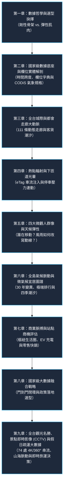

# 📚《台灣動態移動脈搏：國家級交通大數據與微觀人流全景指南》
### Taiwan Mobility Pulse: The Master Guide to National Multi-Modal Mobility & Spatial Intelligence

🌐 **語言切換 / Language**: [ 🇹🇼 繁體中文 ] | [ 🇬🇧 English Version ](en/README.md)

> 「一座城市的呼吸，寫在清晨第一班捷運的刷卡記錄裡；一個國家的脈搏，躍動在午夜奔馳於國道上的重型貨車輪下。」

> 📥 **全書完整版專著**：本書已編纂為出版級電子書（含 9 大巨章、全彩數據結構圖、三向對照表與可點擊互動傳送門）：  
> 👉 **[開啟中文版專著 (v1.3.0 全新觀光即時影像融合典藏版)](../public/docs/taiwan_mobility_pulse_guidebook.pdf)** | **[🇬🇧 English Master Edition (v1.3.0)](../public/docs/taiwan_mobility_pulse_guidebook_en.pdf)**  
> 🌐 **[進入線上閱讀與另存新檔下載中心 ➔](https://tobytoy.github.io/taiwan-mobility-pulse/#download)**

---

## 📖 序言：為什麼需要這本「互動之書」？

在過去，交通大數據專案往往落入兩個極端：

1. **極端一（冰冷的統計報告）**：充斥著難以消化的矩陣、OD 報表與幾百頁的 PDF，缺乏動態生命力，決策者無法直觀感受空間與時間的潮汐。
2. **極端二（炫目卻膚淺的戰情儀表板）**：只有漂浮的粒子、閃爍的亮點，看似具有高科技未來感，卻缺乏**「為什麼要挑選這些資料？」、「數據背後的物理意義是什麼？」、「資料之間如何嚴格互斥與融合？」**的深度論述。

**《台灣動態移動脈搏》** 正是為了打破這種割裂而生。我們透過融合 **交通部 TICP 4.48 億筆真實票證**、**高速公路局 eTag 百萬級門架車種流量**、**TDX 停車與空間機能 API**、**中央氣象署 CODiS 30 年微氣候連續歷史觀測** 以及 **電信信令大數據戰略**，打造了一套具備出版級深度的「互動專著（Interactive Monograph）」。

本手冊如同書籍的章節導讀，將循序漸進引導您探索台灣地表上最震撼的流動規律。每個章節皆附有**專屬的互動地圖超連結**與**手把手操作看點**，讓您邊讀、邊點、邊驗證！

---

## 🗺️ 全書章節結構與導讀地圖 (Table of Contents)

### 📑 各章內容速覽

* **[第一章：數據哲學與選型抉擇——為什麼是「剛性骨架＋彈性肌肉」？](chapter1_data_philosophy.md)**
  * 深入剖析為何跳過「粗放的單一信令」，堅持以「TICP 票證 + eTag 車流」作為地面真理基準點。解構空間零漂移、身分真理標籤、集合天然互斥性與重複計算的工程挑戰。
* **[第二章：國家級數據底座與欄位實體解剖——TICP 票證、eTag 門架、TDX 與 CODiS 歷史氣候觀測大數據規格](chapter2_data_dictionary_and_samples.md)**
  * 解構 4.48 億筆票證、325 座 eTag 門架、TDX 即時停車位與 CWA CODiS 30 年氣候觀測大數據。詳解欄位物理定義、時間顆粒度、去識別化加鹽雜湊防護與多筆真實 JSON 樣本。
* **[第三章：全台城際與都會走廊大動脈——111 條動態走廊的時空潮汐](chapter3_flow_arteries.md)**
  * 解析高鐵、台鐵、五大捷運、產業貨運走廊（竹科/港口）與觀光快線（國五/國六/南迴）的流動規律，解析平日早晚尖峰通勤狂潮與假日大遷徙。
* **[第四章：熱點輻射與下匝道光暈——eTag 車流注入與停車壓力連動](chapter4_etag_halos_heatmap.md)**
  * 全台首創「交流道下匝道車流注入輻射光暈」。追蹤車流下國道後的空間分佈，剖析 16 大戰略交流道、車種配比與 TDX 周邊即時停車位佔用率的強相關性。
* **[第五章：四大微觀人群像與天候彈性——誰在移動？風雨如何改寫動線？](chapter5_personas_weather.md)**
  * 建構鋼鐵通勤族、悠遊銀髮族、求學青年與假日觀光客四大畫像。進入天候實驗室，實證豪大雨時「軌道逆勢抗跌、公車 YouBike 驟降」的彈性係數。
* **[第六章：全島氣候脈動與微氣候宜居圖譜——30 年變異、極端特異區與四季動態潮汐](chapter6_climate_pulse.md)**
  * 直連氣象署 CODiS 30 年大數據，解析雙北熱島升溫 +0.8°C、短延時暴雨集中化、除濕機全載榜（鞍部 98 分、林口 77 分）、天然抗颱避風港（台中 85 分）與 12 個月四季氣候潮汐動態播放。
* **[第七章：商業脈搏與站點商機評估——樞紐生活圈、EV 充電與零售快銷](chapter7_commercial_pulse.md)**
  * 從交通節點躍升為 TOD 商業生活圈。全台 30 大樞紐實證分析，結合商圈消費力、EV 充電樁缺口雷達與一日三餐零售快銷黃金時段。
* **[第八章：國家級大數據融合戰略——門到門閉環與政策落地選型](chapter8_data_fusion_strategy.md)**
  * 提出「1 + 1 + 1 > 3」門到門全日旅程閉環架構。詳解以票證/eTag 硬錨點反向校正電信信令擴推倍率的專利級思維，並提供企業與政府的選型指南。
* **[第九章：全台觀光名勝、景點即時影像 (CCTV) 與假日疏運大數據——山海脈動與即時旅運決策](chapter9_tourism_mobility_cctv.md)**
  * 整合交通部觀光署 74 處 4K/360° 景點即時影像 (CCTV)、中央氣象署 CODiS 歷史氣候、高公局 eTag 假日車流爆發比 (+320%) 與 92 條台灣好行接駁。建立出發前實況預判、氣候舒適度與避開壅塞之四維決策體系。

---

## 🎯 互動地圖快速導航總表 (Interactive Map Quick Index)

透過點擊下列網頁超連結，將直接在新分頁為您開啟線上實時系統並定位至該互動實驗室：

| 章節主題 | 核心探索概念 | 互動地圖傳送門 (點擊直接開啟系統) | 必看關鍵亮點 (Key Highlights) |
| :--- | :--- | :--- | :--- |
| **第一章** 數據哲學 | 空間漂移對比、身分真理標籤、互斥可加性 | [👉 三大數據戰略矩陣](https://tobytoy.github.io/taiwan-mobility-pulse/#telecom) | 查閱 Master Table 三向深度對照矩陣，理解前處理成本差異 |
| **第二章** 數據字典 | 4.48 億筆真實母體、欄位定義、真實樣本 | [👉 數據底座與字典矩陣](https://tobytoy.github.io/taiwan-mobility-pulse/#telecom) | 查看 TICP 票證、eTag 5大車種、TDX 停車位與 CODiS 氣象 JSON 樣本 |
| **第三章** 走廊動脈 | 111 條走廊粒子、產業物流 vs. 觀光快線 | [👉 動態走廊流向圖 (FlowMap)](https://tobytoy.github.io/taiwan-mobility-pulse/#flows) | 切換「平日」與「假日」，拉動時間軸看竹科與國五潮汐 |
| **第四章** 下匝道光暈 | eTag 16 大交流道注入、TDX 停車位壓力 | [👉 時空熱點與注入圈 (Heatmap)](https://tobytoy.github.io/taiwan-mobility-pulse/#heatmap) | 開啟「🛣️ eTag 交流道注入圈」，點擊「愛蘭/日月潭」看停車壓力 |
| **第五章** 人群與天候 | 四大微觀人群像、晴天/豪大雨脆弱性移轉 | [👉 人群像與天候實驗室](https://tobytoy.github.io/taiwan-mobility-pulse/#personas) | 切換「悠遊銀髮族」，選取「豪大雨」，看台北車站長者退潮與移轉 |
| **第六章** 氣候脈動 | 30年變異、極端特異排行、四季潮汐播放 | [👉 氣候脈動實驗室 (Climate Lab)](https://tobytoy.github.io/taiwan-mobility-pulse/#climate-lab) | 點選「四季潮汐播放」，觀察 1~12 月全島天氣圖標跳動與發霉雷達 |
| **第七章** 商業脈搏 | 30 大樞紐生活圈、EV 充電缺口、快銷時段 | [👉 商業脈搏實驗室 (Commercial Lab)](https://tobytoy.github.io/taiwan-mobility-pulse/#commercial-lab) | 點選「台北車站」或「板橋」，查看右側 HUD 面板之商機與充電缺口 |
| **第八章** 全域融合 | 門到門 5 階段閉環、硬錨點反向校正 | [👉 跨源融合與落地選型](https://tobytoy.github.io/taiwan-mobility-pulse/#telecom) | 查閱永和 ➔ 內科西湖之門到門還原圖，以及 TOD 實戰選型建議 |
| **第九章** 觀光與CCTV | 74 處風景區 4K/360° 串流、假日疏運、好行接駁 | [👉 觀光名勝與 CCTV 決策看板](https://tobytoy.github.io/taiwan-mobility-pulse/#tourism) | 點擊「即時 CCTV 串流」觀看現場雲海人潮，查閱 CODiS 歷史適遊期與 eTag 暴增倍率 |

---

## 💡 最佳閱讀與探索建議

1. **雙螢幕或分割畫面閱讀**：建議左側開啟本書 Markdown 章節，右側開啟網頁互動應用，邊閱讀章節中的學術論述，邊在地圖上驗證真實數據。
2. **跟隨引導操作**：每一章皆附有明確的 **【🛠️ 互動操作實戰指引】** 與 **【🔍 資料看點深度剖析】**，按照步驟點擊，能快速發現隱藏在百萬筆數據中的獨特洞察。
3. **帶著問題思考**：例如「為什麼平日早上的大雅交流道貨車比例高達 34%？」、「下大雨時捷運運量真的不會掉嗎？」書中都有詳細的數據印證。

準備好了嗎？讓我們翻開第一章，揭開台灣交通數據源的深層哲學！　👉 **[進入第一章：數據哲學與選型抉擇](chapter1_data_philosophy.md)**
