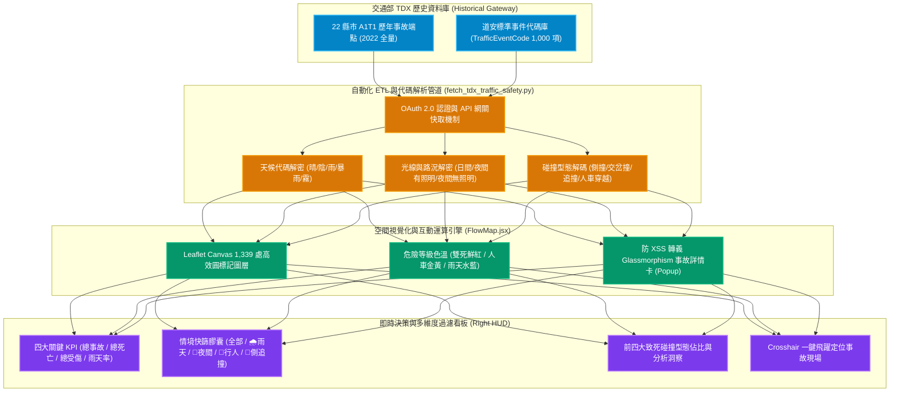
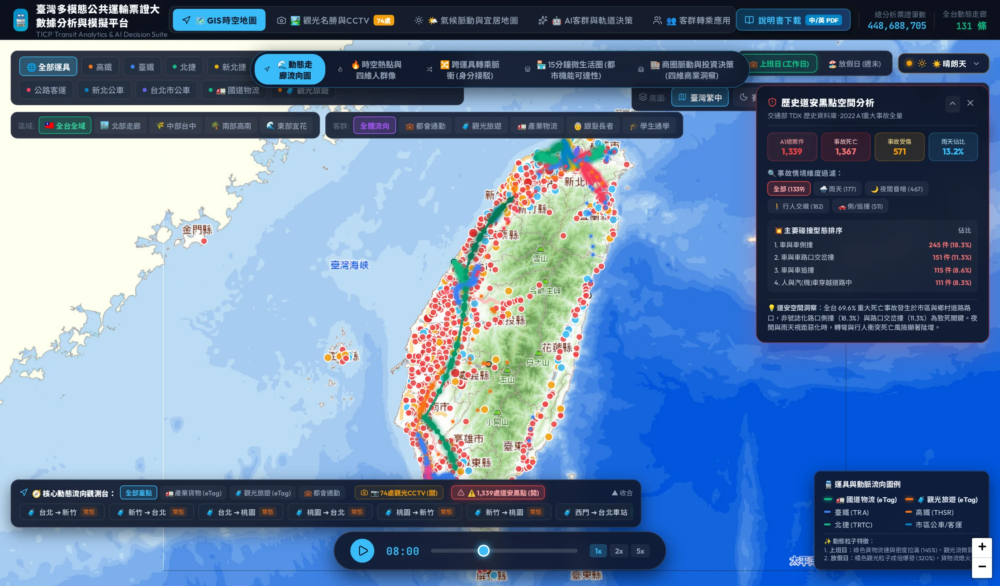
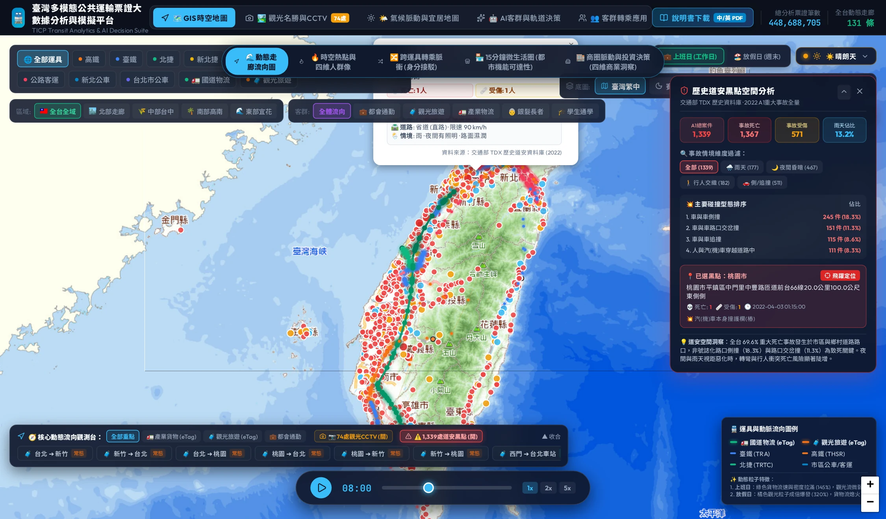
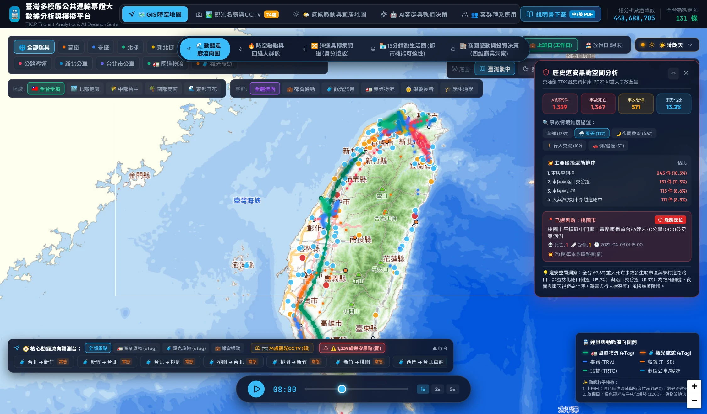

# 第十章：全台歷史道安大數據與 A1 重大事故黑點圖譜——空間衝突、天候易損性與零死亡願景

🌐 **語言切換 / Language**: [ 🇹🇼 繁體中文 ] | [ 🇬🇧 English Version ](en/chapter10_traffic_safety_blackspots.md)

> 「交通運輸的極致價值，不僅在於『如何快速抵達』，更在於『能否平安歸來』。當高鐵、捷運與國道以極高效率串連全島，下匝道後的生活路網與非號誌化路口，是否潛藏著奪命的微觀黑洞？唯有讓數據在空間上說話，方能為零死亡願景（Vision Zero）錨定精準的工程與治理路徑。」

---

## 10.1 道安問題的本質：從「總體傷亡數字」到「精準空間黑點圖譜」

台灣長年面臨嚴峻的道路交通安全挑戰，每年奪走近三千條寶貴生命、造成近五十萬人受傷。過去，公共論述往往停留在抽象的「全年度死亡人數」或道德式的「宣導駕駛專心」，卻難以回答核心的空間與工程問題：

1. **傷亡究竟發生在哪裡？**（是高架國道、市區幹道，還是鄉村未劃線巷弄？）
2. **致命的微觀幾何特徵是什麼？**（是直路超速失控、四岔路搶黃燈側撞，還是無號誌路口的視距死角？）
3. **惡劣天候如何改寫風險？**（暴雨下煞車距離拉長幾成？夜間照明不足路段致死率高出多少？）

為了打破傳統「道安數據分散在各縣市警局、格式不一難以宏觀對照」的痛點，本專案在 **v1.3.2** 全面串接**「交通部 TDX 歷史資料庫（TrafficAccident A1T1）與標準字典（TrafficEventCode）」**，對 2022 全年度全國 22 縣市之 **A1 類重大交通事故（人員當場或二十四小時內死亡）** 進行全量檢索與深度代碼解碼，建構全台首座**動態走廊與歷史道安黑點空間疊合分析圖譜**。

---

## 10.2 TDX 歷史道安大數據架構與數位解碼工程



### 資料源規格對齊表

| 構面 | 數據源端點 | 涵蓋規模 | 核心欄位與解碼成果 |
| :--- | :--- | :--- | :--- |
| **A1 重大事故案件** | `/v1/TrafficAccident/A1T1/{City}` | 全國 22 縣市 1,339 件 | `case_no`（事故案號）、`site`（精確發生地）、`lat/lon`（WGS84 座標）、`time`（精準發生時刻）、`death`（死亡人數）、`injured`（受傷人數）、`speed_limit`（道路速限） |
| **道安事件代碼庫** | `/v1/AccidentBasic/TrafficEventCode` | 1,000 組代碼字典 | `WeatherCode` ➔ 天候中文；`LightCode` ➔ 光線中文；`AccidentPatternsCode` ➔ 碰撞型態；`RoadCategoriesCode` ➔ 道路類別；`PavementConditionCode` ➔ 路面乾濕 |
| **空間流向動態疊合** | 交通流動走廊 + CCTV | 114 條走廊、74 處影像 | 走廊車潮流量、觀光返鄉潮汐與重大黑點碰撞時空重疊分析 |


*圖 10-1：全台 1,339 處 A1 歷史道安重大事故黑點空間分佈與右側即時分析面板（顯示 1,367 死、571 傷之宏觀指標與情境快篩）*

---

## 10.3 全台重大事故黑點之三大關鍵特徵實證解剖

透過對 2022 全量 1,339 起 A1 事故的交叉比對，數據揭示出三項極具震撼力、直擊現行交通規劃弱點的實證發現：

### 一、 道路分佈：近七成死亡事故集中在「市區與村里生活路網」

一般大眾直覺常誤以為「車速極快的高速公路最危險」，但空間統計徹底顛覆了此項刻板印象：

* **市區道路（Urban Roads）**：高達 **687 件（51.3%）**，位居全島之冠。
* **村里道路（Village Roads）**：**245 件（18.3%）**，位居第二。
* **省道（Provincial Highways）**：**210 件（15.7%）**。
* **國道高速公路（Freeways）**：僅 **83 件（6.2%）**。

> **洞察**：高規格封閉型國道具備立體交叉、中央實體分隔島、無行人機車干擾，事故致死總數遠低於開放式路網。**全台高達 69.6% 的死亡事故發生在一般生活路網**，說明「路口混流、轉彎交會、無號誌化盲區」才是奪走國人生命的罪魁禍首。

---

### 二、 碰撞型態 Top 4：側撞與路口衝突高居第一


*圖 10-2：點擊黑點標記展開 Glassmorphism 事故詳情 Popup 彈窗（解碼案號、發生地點、限速、碰撞型態與死傷人數）*

全台 A1 事故碰撞型態呈現極度集中的「路口衝突」特徵：

| 排名 | 碰撞型態 | 件數 | 佔比 | 致命機轉與空間盲區剖析 |
| :---: | :--- | :---: | :---: | :--- |
| **1** | **車與車側撞** | **245 件** | **18.3%** | 支道未停讓幹道、非號誌路口視距不良、搶越路口遭側向高速直擊（車身側面防護脆弱）。 |
| **2** | **車與車路口交岔撞** | **151 件** | **11.3%** | 號誌化路口搶黃燈、左轉車未依號誌搶先轉彎、兩段式左轉動線與直行車嚴重交織。 |
| **3** | **車與車追撞** | **115 件** | **8.6%** | 未保持行車安全距離、駕駛分心（使用手機）、尖峰回堵末端煞車不及。 |
| **4** | **人與汽(機)車穿越道路中** | **111 件** | **8.3%** | 行人穿越道無照明或缺乏行人庇護島、車輛轉彎 A 柱死角未停讓行人、高齡長者穿越無號誌路口。 |
| **5** | **汽機車自撞路樹/電桿/護欄** | **155 件** | **11.5%** | 郊區或彎道超速失控、疲勞駕駛、無防護性路側設施。 |

---

### 三、 天候與光線敏感度：雨天事故與夜間照明盲區


*圖 10-3：啟動「🌧️ 雨天事故 (177件)」情境快篩過濾後的空間黑點圖譜（清晰呈現雨天事故集中於市區幹道與跨城交會路口）*

* **雨天事故（Rain Accidents）**：全年度達 **177 件（佔 13.2%）**。
  - 當降雨發生時，輪胎抓地力下降、煞車制動距離拉長 30%~40%，且擋風玻璃與照後鏡視距嚴重劣化。
  - 數據證實：雨天情境下，**「車與車側撞」與「轉彎衝撞行人」** 的致死風險倍增，尤其在雨天高乘載、通勤車流激增的都會外環幹道最為顯著。
* **夜間光線昏暗（Night & Low Light）**：
  - 夜間有照明路段發生 **411 件（30.7%）**，夜間無照明路段發生 **56 件（4.2%）**，晨暮微光 **65 件（4.9%）**。
  - 合計非全日照時段事故高達 **532 件（佔比 39.7%）**。在無路燈或照明昏暗的鄉間幹道，行人穿著暗色衣物穿越道路幾無生還可能。

---

## 10.4 Web App 互動操作實戰指引

本平臺將道安數據無縫內嵌於核心動態流向地圖中，使用者可依下列步驟體驗：

```
[使用者操作路徑]
開啟首頁 ➔ 點擊底部「🧭 核心動態流向觀測台」
➔ 點選「⚠️ 1,339處道安黑點 (開)」
➔ 地圖即刻亮起全台事故光暈，右側滑出道安分析 HUD
➔ 點選情境膠囊「🌧️ 雨天 (177)」或「🚶 行人交織 (182)」過濾
➔ 點擊地圖任一事故標記查看解碼卡 ➔ 點擊「📍 飛躍定位」縮放至事故路口
```

### 介面設計巧思
1. **顏色心理學與危險分級**：
   - 雙人以上死亡標記賦予 **深紅高危標記（`#DC2626`）**；
   - 行人事故賦予 **警示金黃（`#F59E0B`）**；
   - 雨天事故賦予 **天候水藍（`#38BDF8`）**，一眼即可洞悉事故本質。
2. **與動態走廊的時空疊合**：
   - 使用者可同時開啟「🚛 產業物流」或「🧳 觀光旅遊」走廊，直觀檢視高速車流在下匝道或接駁幹道時，是否正好穿越高風險事故熱點。

---

## 10.5 政策建言：基於大數據的「Vision Zero 零死亡願景」工程策略

本章建立的道安黑點空間圖譜，為台灣各級交通主管機關、都市規劃者與執法單位提供了四項具體落地路徑：

1. **路口幾何改造（Geometric Engineering）**：
   - 針對佔比最高（18.3%）的側撞事故，全面推動**非號誌化路口退縮、視距三角障礙清除、小型圓環（Mini-roundabout）或減速抬升平台（Raised Intersection）**，強制降低車輛通過路口之橫向衝擊動能。
2. **行人安全專屬庇護（Pedestrian Refuges）**：
   - 針對佔比 8.3% 的人車穿越事故，凡跨越四線道以上之路口，中央實體分隔島必須留設寬度 1.5 公尺以上之**行人庇護島**，並全面升級為**行人早開時相（Leading Pedestrian Interval, LPI）**。
3. **微氣候連動動態科技執法（Weather-Responsive ITS）**：
   - 整合中央氣象署降雨測站大數據，於雨天事故多發幹道建置「降雨動態速限標誌」，於豪大雨時段自動將速限由 60 km/h 調降至 40 km/h，並透過門架預警駕駛拉長安全車距。
4. **推動 TPASS 跨運具移轉以降低暴露風險（Mode Shift for Safety）**：
   - 實證顯示公共運輸（公車、捷運、鐵路）之每延人公里傷亡風險僅為私有汽機車的數百分之一。持續優化 TPASS 定期票服務範圍與轉乘友善度，將私人運具使用者移轉至大眾運輸，是徹底降低整體傷亡基數的最有效解方。

---

👉 **[返回全書目錄](README.md)** | **[前往第九章：觀光名勝與景點即時影像 (CCTV)](chapter9_tourism_mobility_cctv.md)**
