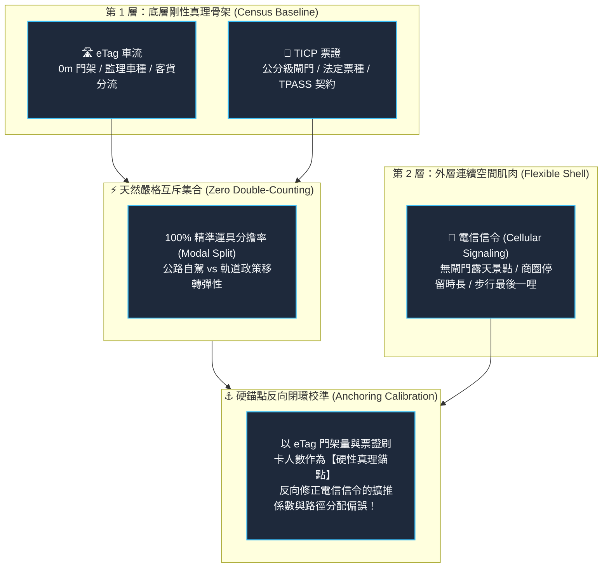
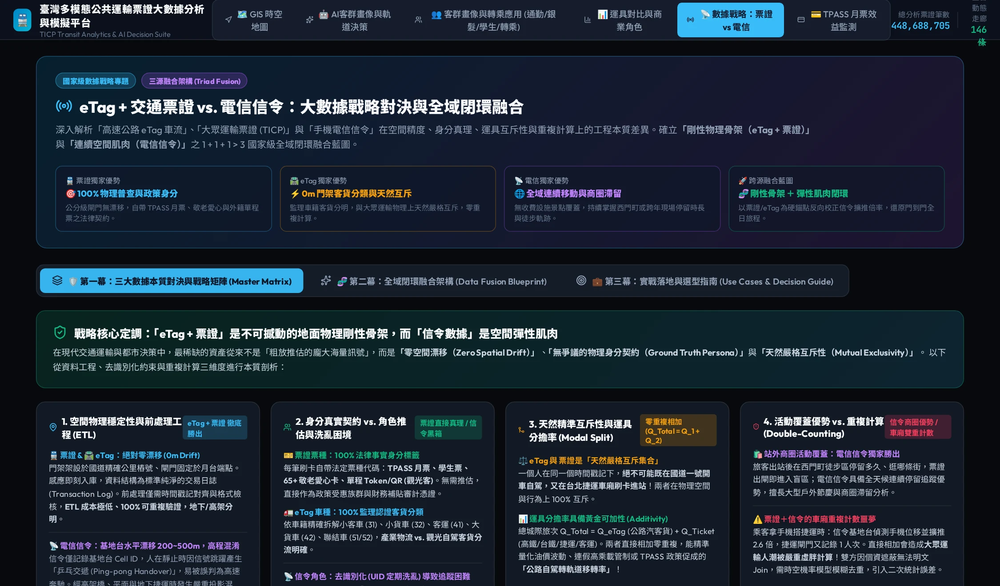

# 第一章：數據哲學與選型抉擇——為什麼是「剛性骨架＋彈性肌肉」？

🌐 **語言切換 / Language**: [ 🇹🇼 繁體中文 ] | [ 🇬🇧 English Version ](en/chapter1_data_philosophy.md)

> 「在資料科學的世界裡，海量不等於精確。若基礎座標在漂移、身分全靠猜測，再複雜的神經網路也只是在放大幻覺。」

---

## 1.1 交通大數據的永恆難題：雜訊與推估的代價

在過去十年間，智慧交通與人流分析最常遭遇的挫敗，就是「對單一資料源的過度迷信」。
許多專案試圖單純依賴「手機電信信令（Cellular Signaling Data）」來解決所有的都市問題：從捷運客流、路網壅塞到商圈消費。然而，當專案進入審計、驗收或精細規劃時，往往浮現巨大的落差：

* **為什麼捷運地下三樓月台的人，會被信令判定在上方的高架橋上開車？**
* **為什麼信令推估出的人次，無法拿來發放政府百億元的 TPASS 預算補貼？**
* **為什麼使用者連續停留了 8 小時，我們卻不知道他是上班族、學生還是外籍遊客？**

交通大數據的真正挑戰，從來不是「數據量夠不夠大」，而是**資料工程的本質屬性**。
本專案在立項之初，便確立了核心的資料哲學：**「以零漂移的物理剛性真理作為骨架，以全域連續空間作為肌肉」**。

---

## 1.2 為什麼選擇 TICP 交通票證大數據？（公分級剛性真理）

我們選用了交通部 TICP（運輸資料流通服務平臺）高達 **4.48 億筆** 的真實票證大數據，作為本研究的核心公共運輸基石。它的不可替代性體現在三個「絕對維度」：

1. **100% 物理全量普查（Census，非抽樣擴推）**：
   每一次刷卡進出站，都是一筆帶有金融交易憑證的實體紀錄。沒有所謂「市佔率乘上 2.7 倍」的統計抽樣擴推偏差，數據就是真實的物理客流。

2. **法律契約與法定票種（Ground Truth Persona）**：
   每筆票證紀錄自帶法定身分標籤：

   * `TicketType=4`：**TPASS 通勤月票**（政策受惠的重度通勤剛需族）。
   * `TicketType=03/04`：**敬老愛心卡**（65+ 長者或身障族群，享有地方政府法定補貼）。
   * `TicketType=02`：**學生卡**（國高中大專學生，尖峰接送與通學模式）。
   * `Token / QR 單程票`：**境外觀光客或偶發搭乘者**。
   身分是「客觀法律事實」，完全無需演算法通靈猜測。

3. **公分級月台與垂直高度定位（Z 軸精度）**：
   閘門精確架設在地下二樓、地下三樓或高架月台。無論地面遮蔽如何嚴重，刷卡進站即 100% 確立該人次身處軌道系統內部，徹底杜絕高程混淆。

---

## 1.3 為什麼選擇 eTag 高速公路車流？（0m 門架客貨分流）

在公路運輸與城際走廊領域，我們納入了高速公路局 eTag 百萬級車流大數據：

1. **0m 樁號精準度，絕對零空間漂移（Zero Drift）**：
   eTag 微波感應門架固定架設在國道精確的公里樁號（如國道一號 23.4k）。車輛通過即紀錄，座標固定不變，資料清洗只需做時間格式檢查，無需耗費算力做路網投影。

2. **監理車籍 5 大車種分類（客貨分離的生命線）**：
   eTag 系統依據車籍與車軸數，將車流精準拆解為：

   * `車種 31`：小客車（私家通勤、家庭旅遊）。
   * `車種 32`：小貨車（都會短途配送、工班車輛）。
   * `車種 41`：大客車（國道客運、觀光遊覽車）。
   * `車種 42`：大貨車（城際幹線重型物流）。
   * `車種 51/52`：聯結車／半聯結車（國際商港貨櫃、鋼鐵重工業）。
   這使我們能夠看見台灣真實的「產業物流骨骼」，這是任何公共運輸票證無法觸及的領域。

3. **與票證具備「天然精準互斥性（Mutual Exclusivity）」**：
   一個人同一秒鐘，絕不可能「既在國道上自駕，又在捷運車廂刷卡」！因此：
   $$\text{總城際走廊流量 } Q_{\text{Total}} = Q_{\text{eTag (公路汽客貨)}} + Q_{\text{Ticket (軌道/客運)}}$$
   **兩者可直接相加，零重複計數**，是計算全台「運具分擔率（Modal Split）」最純淨的黃金組合。

---

## 1.4 為什麼結合 TDX 停車與生活圈機能？

車輛從高速公路下匝道後，並不會憑空消失。
車流注入周邊平面市區後，首當其衝的就是**「停車空間承載力」**與**「生活圈零售機能」**。
因此，我們將 TDX 即時停車位 API、生活機能設施密度（充電樁、超商、量販店）與交流道下匝道車流進行深度關聯，讓宏觀的高速公路車流能夠無縫落地為微觀的「生活圈都市承載力指標」。

---

## 1.5 電信信令的局限：空間漂移、UID 洗亂與車廂重複計算

手機電信信令（Cellular Signaling）在全域覆蓋上極具價值，但在交通資料工程中存在三大致命痛點：

1. **空間漂移與乒乓交遞（Ping-pong Handover）**：
   基地台半徑在市區約 200~500m。當使用者靜止不動時，手機頻繁切換鄰近基站，演算法極易誤判為高速移動；當遇到高架橋與地下捷運時，更是分不清人在哪一層。

2. **去識別化洗亂導致旅次鏈斷裂**：
   為遵守《個人資料保護法》，電信業者的臨時 ID（IMSI/UID）通常每天或每週重新 Hash 洗亂，並在空間網格中注入微擾噪音。**一旦 UID 被洗亂，就無法進行跨週跨月的連續旅次鏈追蹤**，分不清常客與偶發過客。

3. **車廂雙重計數（Double-Counting）**：
   當乘客搭捷運時，信令基站偵測到手機並擴推 2.6 倍，捷運閘門又記錄 1 次。若直接將信令與票證相加，**捷運車廂的人潮會被嚴重虛胖放大**！若要扣除重複，因缺乏明文個資，只能用機率猜測，再次引入二次估計誤差。

---

## 1.6 戰略定調：三大數據源「剛性骨架＋彈性肌肉」融合典範

基於上述本質剖析，本專案確立了國家級大數據融合戰略架構：

*圖 1.1：線上系統【數據戰略：票證 vs 電信】第一幕——四大核心維度對決卡片（空間穩定性、身分契約、天然互斥性、活動覆蓋與重複計算），直觀展示剛性骨架如何奠定零漂移基準。*

---

## 1.7 🛠️ 互動操作實戰指引：如何在系統中切換查看

想要親自體驗本章所論述的「三大數據戰略對決矩陣」嗎？請依以下步驟操作：

* **[👉 立即跳轉至線上系統：三大數據戰略矩陣 (Master Matrix)](https://tobytoy.github.io/taiwan-mobility-pulse/#telecom)**

### 操作步驟：
1. 點擊上方超連結或點擊系統頂部導覽列 **【電信與票證】**。
2. 預設進入 **【🛡️ 第一幕：三大數據本質對決與戰略矩陣 (Master Matrix)】** 子頁籤。
3. 閱讀頁面中四張對決卡片（空間物理穩定性、身分真實契約、天然互斥性、活動覆蓋與重複計算）。
4. 向下滑動至 **「三大數據源（eTag vs. 票證 vs. 信令）全戰略維度三向對照總表」**，橫向對比 8 大指標。

---

## 1.8 🔍 核心資料看點與思考

> **💡 讀者思考題**：
> 當政府準備審計「TPASS 行政院通勤月票 1200 方案」一年花了 100 億元公帑是否值得時：
> * 能否拿電信信令的推估數字向主計總處核銷經費？（**不行，缺乏法律交易契約與確切票種代碼**）
> * 為什麼必須使用 TICP 票證大數據？（**因為每一筆都是不可磨滅的金融與核銷憑證**）
> * 為什麼需要搭配 eTag？（**用來證明國道自駕車流是否真的減少，以及減少的車流去了哪裡**）

至此，我們確立了數據源的底層哲學。在下一章，我們將深入資料庫最底層，逐一解剖 TICP 票證、eTag 門架與 TDX 的真實數據欄位字典與樣本！

👉 **[進入第二章：國家級數據底座與欄位實體解剖](chapter2_data_dictionary_and_samples.md)**
