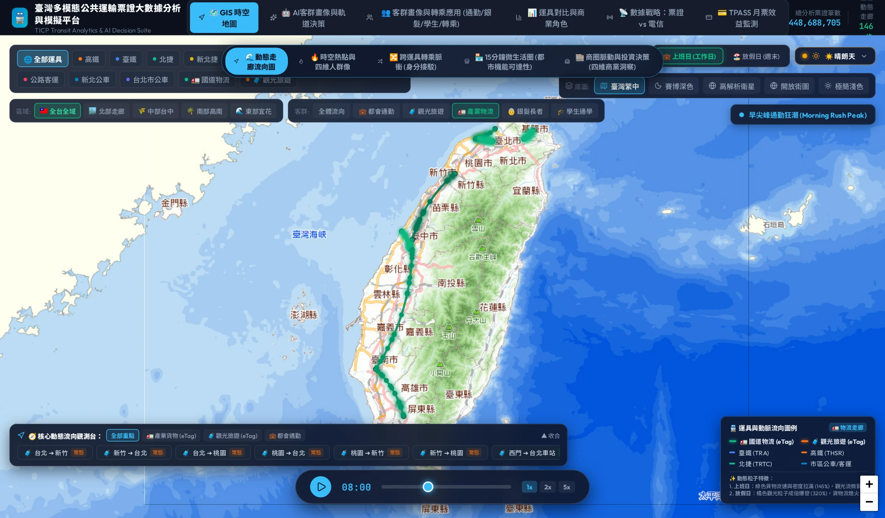
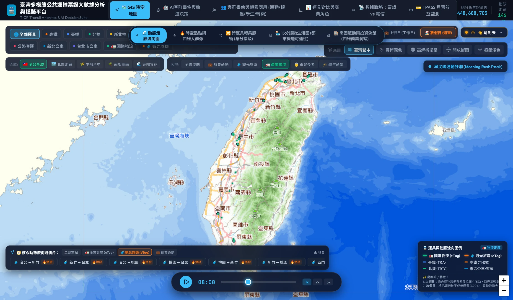

# 第三章：全台城際與都會走廊大動脈——111 條動態走廊的時空潮汐

> 「如果台灣是一具鮮活的有機體，那麼 111 條動態走廊就是它的動靜脈血管；奔騰的粒子不是代碼，而是兩千三百萬人每天生活的軌跡。」

---

## 3.1 走廊網絡建構原理：從「孤立站點」到「連通向度」

傳統交通統計往往停留在「單一車站進出人次」的孤立排行榜（例如：台北車站第一名、板橋車站第二名）。然而，這種點狀思維無法回答交通規劃的核心問題：**人到底從哪裡來、要到哪裡去？中途經過哪些關鍵瓶頸？**

本系統打破單點思維，透過 TICP 票證交易紀錄之進出站對碰（OD Matching），結合 eTag 門架連續通行路徑，抽樣建構出全台灣 **111 條最具代表性的動態走廊（Mobility Corridors）**。
走廊涵蓋五大多模態運具：

1. **高鐵（THSR）**：西部走廊 350 公里一日生活圈主脊椎。
2. **台鐵（TRA）**：環島城際幹線與各縣市區間通勤動脈。
3. **都會捷運（Metro）**：北捷、新北捷、桃捷、中捷、高捷之高密度都會內人潮微循環。
4. **公路客運（Highway Bus）**：跨縣市直達通勤客運（如基隆 ↔ 台北、南崁 ↔ 台北）。
5. **國道貨運與觀光幹線（Highway Freight & Tourism）**：eTag 實測之產業重鎮與休閒廊道。

---

## 3.2 產業物流大動脈：夜間不眠的重型動脈

台灣是全球高科技硬體與製造重鎮，除了白天的上班族之外，地表上還有一條巨大的「暗流」——**產業貨運走廊（Freight Corridors）**。透過 eTag 門架之車種 32（小貨）、42（大貨）與 51/52（聯結車）通行紀錄，我們還原了台灣三大關鍵科技物流走廊：

1. **國道一號科技幹線（竹科 ↔ 台北港 / 桃園機場）**：
   * **起訖路徑**：新竹科學園區 ➔ 國一/台66 ➔ 台北港與遠雄自貿港。
   * **流動特性**：高單價半導體晶圓、精密電子零組件之 24 小時急件通關。深夜 00:00 至 04:00 依然維持極高比例之廂型大貨車流。
2. **中台灣港科聯動走廊（台中港 ↔ 中部科學園區大雅）**：
   * **起訖路徑**：台中港貨櫃碼頭 ➔ 台74 / 國道四號 ➔ 中科台中基地。
   * **流動特性**：離岸風電重型機具、晶圓代工化學槽車與精密機械進出口。
3. **南台灣半導體 S 廊帶（高雄港 ↔ 南科新市）**：
   * **起訖路徑**：高雄港前鎮貨櫃專用道 ➔ 國一/台86 ➔ 台南科學園區。
   * **流動特性**：高屏重工業原料與南科三奈米晶圓先進製程之供應鏈流動。


*圖 3.1：篩選「🚛 產業物流」客群之流向地圖。高亮顯示國道一號科技幹線（竹科 ↔ 台北港/桃機）與中港科聯動走廊，高單價晶圓零組件與進出口重櫃車流全天候奔馳。*

---

## 3.3 假日觀光快線：從水泥都會向山海大遷徙

與平日通勤截然不同，每逢週末或連續假期，全台灣的人流向量會發生劇烈的「極性反轉（Polarity Inversion）」。人潮迅速撤離都市核心，湧入四大國家級觀光廊道：

1. **國道五號雪隧宜蘭快線（南港 ↔ 礁溪/羅東）**：
   * 平日僅為區域性通勤客流；**週六上午 07:00~11:00 南下車流暴增 280%**，週日下午 14:00~20:00 北上形成長達數十公里的返潮車龍。
2. **國道六號愛蘭日月潭走廊（台中霧峰 ➔ 埔里/愛蘭）**：
   * 銜接中部都會區前往清境農場、日月潭與合歡山的核心樞紐，假日小客車（車種 31）佔比超過 88%。
3. **南迴觀光走廊（屏東南州 ➔ 墾丁恆春）**：
   * 南台灣陽光度假主幹線，週五傍晚開始南下車流激增，週日收假前夕回流屏東市區與國三南州交流道。
4. **花東縱谷休閒快線（台東 ➔ 礁溪/花蓮）**：
   * 鐵路新自強號（EMU3000）與台9線蘇花改自駕車流雙軌並行，展現高度休閒轉化率。


*圖 3.2：切換至「🏖️ 放假日 (週末)」及「🧳 觀光旅遊」客群。平日向心通勤走廊大幅降溫，國道五號雪隧宜蘭快線、國道六號愛蘭走廊與花東縱谷粒子流暴增 320%。*

---

## 3.4 24 小時時空潮汐全景規律

當我們拉動系統中的 24 小時時間軸時，能清楚看見台灣全日的移動節奏：

```
00:00 ── 05:00 │ 深夜靜息期：公共運輸收班，國道幹線貨運車流（42/51）占主導
07:00 ── 09:00 │ 早尖峰通勤狂潮：輻射狀湧入台北、板橋、竹科、台中、高雄中心
11:00 ── 14:00 │ 午間商務與社交移動：各生活圈核心短程移動、午餐與洽公
17:00 ── 19:30 │ 晚尖峰返家大遷徙：反向衝出都會核心，走廊粒子流速達到全日極限
21:00 ── 23:30 │ 夜間歸宿與文娛活動：信義商圈、逢甲夜市、六合夜市等休閒散場
```

---

## 3.5 🛠️ 互動操作實戰指引：如何在動態流向地圖中體驗

* **[👉 立即跳轉至線上系統：全台動態走廊流向圖 (FlowMap)](https://tobytoy.github.io/taiwan-mobility-pulse/#flows)**

### 操作步驟：
1. 點擊上方超連結或點擊頂部導覽列 **【GIS 空間地圖】➔【動態走廊流向】**。
2. **觀察時間軸潮汐**：
   * 在畫面下方找到時間軸控制列，點擊 **「播放 (Play)」** 按鈕，觀察時間從 00:00 推進至 23:00。
   * 注意早尖峰 **08:00** 與晚尖峰 **18:00** 時，雙向走廊上高密度流動的光流粒子。
3. **切換「平日 (Workday)」與「假日 (Holiday)」**：
   * 在頂部或左側面板切換日型：
   * 觀察 **平日** 下，基隆 ➔ 台北、竹科周邊與捷運路網的藍色粒子極速密集湧入；
   * 觀察 **假日** 下，國道五號、國道六號與東部走廊的金色/橘色觀光粒子顯著增加。
4. **利用「走廊快捷雷達面板」聚焦特定走廊**：
   * 在地圖右側或下方「重點走廊導航」中，點選 **「竹科科技幹線」** 或 **「國五宜蘭度假快線」**；
   * 地圖會自動平移放大（FlyTo）至該走廊，並高亮顯示其 Origin-Destination 坐標與粒子流速！

---

## 3.6 🔍 核心資料看點深度解碼

> **💡 專業看點推薦**：
> 1. **早尖峰 08:00 的「竹科科技幹線」**：
>    觀察從國道一號新竹交流道匯入竹科的粒子流，對比同時段台鐵新竹站往返六家支線的客流，能夠看見科技從業人員自駕與鐵道接駁的雙軌平衡。
> 2. **晚尖峰 18:00 的「基隆 ➔ 台北 國道客運」**：
>    反向觀察台北轉運站與市府轉運站往基隆方向的粒子，展現 TPASS 實施後城際公路客運龐大的跨縣市疏運能量。

在走廊宏觀尺度之後，我們需要進一步問：當車輛離開高速公路交流道、進入平面市區時，周邊的空間是如何被擾動的？
下一章，我們將帶您走進微觀熱點，揭示全台首創的「交流道下匝道輻射光暈」！

👉 **[進入第四章：熱點輻射與下匝道光暈](chapter4_etag_halos_heatmap.md)**
