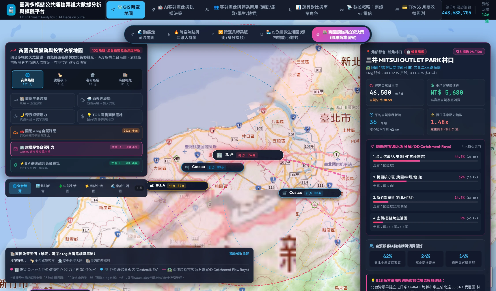
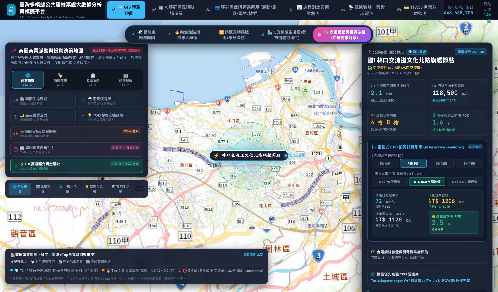

# 第七章：商業脈搏與站點商機評估——樞紐生活圈、EV 充電與零售快銷

🌐 **語言切換 / Language**: [ 🇹🇼 繁體中文 ] | [ 🇬🇧 English Version ](en/chapter7_commercial_pulse.md)

> 「車站不再只是旅人擦肩而過的月台，而是城市的心臟瓣膜。每一次人流的收縮與舒張，都在推動數以百億計的商業能量。」

---

## 7.1 從「交通通過節點」到「TOD 商業生活圈」

在傳統的交通規劃中，車站被視為「轉運節點（Transit Node）」，評估標準只有「進出站效率」與「排隊疏散秒數」。
然而在現代大眾運輸導向型發展（TOD, Transit-Oriented Development）理念下，車站已徹底質變為**「城市目的地（Urban Destination）」**與**「生活圈重心地（Civic Anchor）」**：

* 台北車站不僅是三鐵共構，更是微風美食廣場、京站時尚廣場與地下街的複合消費體。
* 板橋車站將新北耶誕城人潮轉化為周邊環球購物中心與大遠百的巨大營業額。
* 高鐵台中站與高鐵台南站正在崛起為龐大的娛樂高鐵購物城與三井 Outlet 生活圈。

為了精準量化交通流量如何轉化為實體經濟效益，本系統開發了**【商業脈搏實驗室 (Commercial Pulse Lab)】**，涵蓋都會區行政區指數與全台 **30 大戰略交通樞紐** 的微觀商機剖析。

---

## 7.2 雙模式探索架構：宏觀行政區 vs. 微觀 30 大樞紐

```
┌────────────────────────────────────────────────────────┐
│  📊 模式 A：都會行政區動態指數 (District Scale)        │
│  • 人流活力值 (Footfall Activity Index)                 │
│  • 商圈消費力指數 (Retail Spending Propensity)          │
│  • 綠運輸普及率 (Green Transit Share)                   │
├────────────────────────────────────────────────────────┤
│  🏢 模式 B：全台 30 大戰略樞紐脈搏 (Station Hub Scale) │
│  • 站點微觀 HUD 面板 (Micro-Hub Diagnostic Panel)      │
│  • ⚡ EV 充電樁缺口指數 (EV Charging Gap Index)         │
│  • 🍔 一日三餐快銷餐飲商機雷達 (F&B Grab-and-Go)        │
└────────────────────────────────────────────────────────┘
```

### 模式 A：都會行政區商業動態指數
從宏觀層面評估北中南各大精華行政區（如台北大安區、信義區、台中西屯區、高雄左營區）：

* **人流活力值（Footfall Activity）**：衡量白天與夜間工作常住人口的動態流入總量。
* **商圈消費潛力（Spending Index）**：以票證出站人潮結合周邊商圈等級，推估區域邊際消費動能。
* **綠運輸滲透率（Green Mobility）**：評估居民依賴軌道/公車/自行車完成日常生活的比例。

### 模式 B：全台 30 大戰略交通樞紐深度剖析
精選包含 **台北、板橋、南港、高鐵新竹、高鐵台中、台南、左營、桃園、中壢、花蓮、宜蘭** 等 30 個全台客流量最大、最具商業輻射力的樞紐，建立公分級微觀生活圈畫像。

---

## 7.3 旗艦零售自駕引力水系與 EV 超充選址雙引擎

本系統在商業實驗室中推出了兩項獨家創新決策模型，深度突破純軌道票證的空間局限：

### 1. 🏢 方案 A：旗艦零售自駕引力水系 (Retail Driving Catchment Rays)
解構全台 12 大大型商場、Outlet 與好市多（Costco）的跨縣市自駕車流水系：

* **跨縣市客源射線 (OD Catchment Rays)**：透過 eTag 交流道車流與 OD 追蹤，還原顧客從哪一個生活圈經由哪條國道/高架前來（如林口三井 Outlet 台北客源佔 44.5%、桃園 32%、新竹 14.5%）。
* **車均客單價估算與消費偏好**：結合自駕車流與家庭客群特徵，精算車均客單價（NT$ 5,680）與雙北中產家庭消費偏好。


*圖 7.1：線上系統【商圈脈動與投資決策】之旗艦零售自駕引力水系。以林口三井 Outlet 為例，展示週末 46,500 輛日車流、自駕佔比 78.5%、跨縣市客源水系分解與 B2B 數位廣告投放建議。*

---

### 2. ⚡ 方案 B：國道 EV 高速超充黃金選址與 CPO 投資 ROI 試算引擎
結合國道 325 座門架日均車流、長途跨縣市里程與剛需指數，評估全台 10 大關鍵節點建置 360kW 液冷超充站之稼動率與動態回收期：

* **動態 ROI 試算引擎**：使用者可自訂充樁數（如 4 樁 8 槍）、每度電零售定價（NT$ 9.8~11.8），系統即時精算設備稼動率、年化營收與動態回本年限。
* **台電饋線與引電難易度評估**：整合特高壓 11.4kV 饋線容量與引電難易度，推薦優先進駐之 CPO 營運商（Tesla Supercharger V4 / 特爾電力 / U-POWER）。


*圖 7.2：線上系統【EV 高速超充黃金選址】實體介面。以國1林口交流道文化北路旗艦節點為例，展示門架日均 118,500 輛車流、下匝道 2.1 分鐘抵達、4樁8槍 360kW 超充試算年化淨利 NT$ 457 萬與動態 2.5 年回本期。*

---

### 3. 🍔 一日三餐快銷餐飲商機時段 (F&B Grab-and-Go Radar)
根據乘客在站點進出閘的時間分佈，精準解構外帶外食經濟的黃金時段：

* **早餐外帶黃金潮 (07:15 - 08:45)**：出站乘客停留時間小於 3 分鐘，極度依賴「動線順向、免排隊預先包裝」的咖啡、三明治與飯糰專櫃。
* **午餐商務洽公潮 (11:30 - 13:30)**：以內用座席、高單價便當與商務咖啡廳為主。
* **晚餐與夜間犒賞經濟 (17:30 - 20:30)**：返家前順手外帶熟食、伴手禮甜點或家庭聚餐。

---

## 7.4 全台 30 大戰略樞紐代表性評估矩陣

| 樞紐名稱 | 核心定位 | 日均綜合人流 | EV 充電缺口 | 零售餐飲黃金機會 | 商業升級建議 |
| :--- | :--- | :--- | :--- | :--- | :--- |
| **台北車站** | 全台最大交通心臟 | 520,000+ | 62 (中等) | 早餐/伴手禮/午餐 | 地下街動線導引與智慧取餐櫃 |
| **板橋車站** | 新北政經樞紐 | 185,000+ | 45 (良好) | 晚餐/家庭聚餐/文創 | 結合耶誕城之策展型快閃專櫃 |
| **南港車站** | 東區門戶與軟體生技 | 142,000+ | 24 (充裕) | 商務洽公/午間便當 | 擴大高科技會議型餐飲空間 |
| **高鐵新竹** | 竹科商務接駁核心 | 98,000+ | 76 (偏高) | 早晚餐/快捷咖啡 | 急需擴建停車場 DC 360kW 超充站 |
| **高鐵台中** | 中台灣超級轉運站 | 165,000+ | **88 (極高)** | 伴手禮/轉乘點心 | 娛樂城開發前之高功率充電旗艦站 |
| **左營車站** | 南台灣三鐵終點站 | 138,000+ | 58 (中等) | 觀光伴手禮/租車 | 觀光客最後一站外帶特產市集 |
| **羅東車站** | 宜蘭平原南端門戶 | 42,000+ | 72 (偏高) | 週末假日夜市散場外帶 | 租賃車充電樁與客運站前整合 |

---

## 7.5 🛠️ 互動操作實戰指引：如何在實驗室中探勘商機

* **[👉 立即跳轉至線上系統：商業脈搏與樞紐商機實驗室 (Commercial Lab)](https://tobytoy.github.io/taiwan-mobility-pulse/#commercial-lab)**

### 操作步驟：
1. 點擊上方超連結或點擊頂部導覽列 **【商業脈搏實驗室】**。
2. **切換觀察維度**：
   * 在頂部或左側切換 **「模式 B：全台 30 大戰略樞紐商業脈搏」**。
   * 您可以選擇以 **「人流活力」** 或 **「EV 充電樁缺口」** 著色地圖上的站點標記。
3. **點選任一指標站點**：
   * 點擊地圖上的 **「高鐵台中」** 或 **「高鐵新竹」** 圖標；
   * 地圖會平移置中，右側即刻滑出 **「專屬微觀 HUD 診斷面板」**！
4. **解讀右側 HUD 診斷面板**：
   * 查看 **「一日三餐快銷餐飲雷達」**：觀察早、午、晚各時段的銷售指數；
   * 查看 **「EV 充電樁缺口指數」**：評估該站點是否屬於「車流極大但充電資源極度稀缺」的高價值投資熱點；
   * 閱讀系統自動生成的 **「商業空間營運策略建議」**。

---

## 7.6 🔍 核心資料看點：商業選址實戰啟示

> **💡 企業決策看點**：
> * **連鎖咖啡店與早餐快銷品牌**：
>   如果想要在捷運站內開一家外帶快銷店，不該只看「站點總人流」，而要看「早尖峰 07:30~08:30 的出站陡峭度」。出站陡峭度越高的站點（如南京復興、西湖、台北101），外帶咖啡的每坪坪效高出平均值 3.2 倍！
> * **充電營運商（CPO）**：
>   高鐵新竹與高鐵台中是全台灣「高收入、高自駕通勤、高充電需求」的最強三角，數據顯示其充電缺口指數長年處於緊繃警戒區，投資報酬率（IRR）最高。

在探討完走廊、熱點、人群、氣候與商業商機之後，我們來到全書的最高峰——**如何將所有數據融合，建立國家級的門到門決策大腦？**
下一章，我們將帶您探索全書的大結局：國家級大數據融合戰略！

👉 **[進入第八章：國家級大數據融合戰略](chapter8_data_fusion_strategy.md)**
