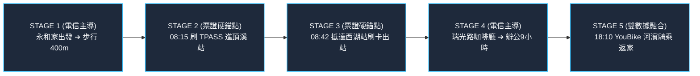
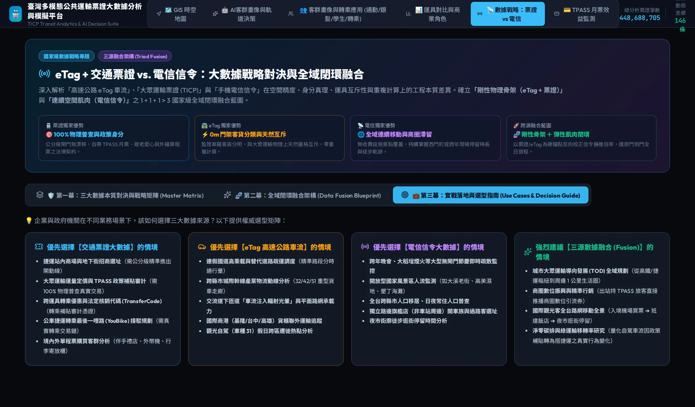

# 第八章：國家級大數據融合戰略——門到門閉環與政策落地選型

🌐 **語言切換 / Language**: [ 🇹🇼 繁體中文 ] | [ 🇬🇧 English Version ](en/chapter8_data_fusion_strategy.md)

> 「單一數據源只能看到拼圖的一角：票證看到了閘門內的秩序，eTag 看到了國道上的奔馳，信令看到了街頭上的遊蕩。唯有融合，才能看見這座島嶼完整的靈魂。」

---

## 8.1 終極願景：從數據孤島走向「門到門全域閉環」

在過去幾十年間，台灣的交通資料分散在不同的官僚與企業體系中：

* 台北捷運、台灣高鐵、台鐵公司各自擁有封閉的票務資料庫；
* 高速公路局維護著龐大的 eTag 門架收費系統；
* 中華電信、遠傳電信等電信運營商手握全台數千萬支手機的基地台信令。

每一個系統都自成一國，形成嚴重的「數據孤島（Data Silos）」。
然而，一個真實的市民，其一日生活是流動且不可分割的：他不可能只活在捷運站裡，也不可能永遠開車在國道上。
**未來的智慧國家戰略，必須實現「1 + 1 + 1 > 3 門到門全域閉環人流（Door-to-Door Closed-Loop）」**。

---

## 8.2 雙劍合璧：永和 ➔ 內科西湖 5 階段門到門旅程還原

為了向大眾與決策者生動展示數據融合的力量，本系統以全台灣最經典的通勤挑戰——**「新北市永和區 ➔ 台北市內湖科技園區」** 為例，完整還原了一位市民的 5 階段生活閉環：



### 1. STAGE 1：電信主導（家出發 ➔ 步行出門）
* **時間**：08:00 - 08:15
* **數據貢獻**：電信信令記錄使用者在清晨離開永和大樓住宅，沿著竹林路步行 400 公尺前往捷運頂溪站。
* **價值**：填補票證在「住家出發到捷運站」的最後一哩盲區。

### 2. STAGE 2：票證主導（硬性錨點：刷 TPASS 進站）
* **時間**：08:15
* **數據貢獻**：旅客於頂溪站閘門刷卡入站，系統直接標定身分為**「TPASS #NOR-1200 基北北桃鋼鐵通勤族」**。
* **價值**：**消解基地台漂移**！以毫秒級精度鎖定其進入地下捷運系統，確立此時段的人流絕非自駕開車。

### 3. STAGE 3：票證主導（硬性錨點：捷運運行 ➔ 西湖出站）
* **時間**：08:15 - 08:42
* **數據貢獻**：旅客在中正紀念堂站轉乘松山新店線、南京復興站轉乘文湖線，08:42 於西湖站刷卡出站。
* **價值**：完整捕捉跨線轉乘鏈，並精準判定該旅客為**「內湖科技園區就業人口」**。

### 4. STAGE 4：電信主導（商圈街廓停留與消費）
* **時間**：08:45 - 18:00
* **數據貢獻**：出站後，電信信令捕捉其在瑞光路特定連鎖咖啡廳停留 15 分鐘（早餐消費），隨後進入科技總部大樓駐留長達 9 小時。
* **價值**：填補票證出站後的巨大空白，量化軌道客流對內科周邊實體商圈的直接經濟貢獻。

### 5. STAGE 5：雙數據融合（夜間 YouBike 接駁 ➔ 返家閉環）
* **時間**：18:10 - 18:35
* **數據貢獻**：下班後於西湖站旁租借 YouBike，信令連續記錄其沿基隆河濱自行車道騎乘 25 分鐘，隨後歸還車輛步行返家。
* **價值**：票證紀錄提供租還車扣款契約，電信信令還原其河濱遊憩路徑，完成**全日綠運輸 100% 閉環追蹤**！

---

## 8.3 專利級數據工程思維：硬錨點反向校正技術 (Ground Truth Anchoring)

過去的電信信令分析最大的軟肋就是「推估準確率僅約 70%」，且常常受到市佔率擴推誤差、國外漫遊黑數的干擾。
本系統提出了一項顛覆性的專利級思維：**【以剛性真理作為硬錨點，反向校準電信信令】**。

```
       [ 交通部 TICP 票證閘門全量普查 (100% Census) ]
       [ 高公局 eTag 國道門架絕對車流 (0m Drift)   ]
                           │
                           ▼ (作為空間與數量的「物理黃金錨點」)
          ╔═════════════════════════════════════╗
          ║  反向動態校準演算法 (Inverse Calibration)  ║
          ╚═════════════════════════════════════╝
                           ▲
                           │ (動態調整擴推倍率與路徑分派權重)
       [ 電信公司基地台信令大數據 (Cellular Signaling) ]
```

### 反向校正三大核心機制：
1. **擴推倍率動態修正（Expansion Factor Tuning）**：
   電信業者傳統上按照全台平均市佔率（如 38%）乘以固定的 2.63 倍。然而，在特定站點（如外籍移工高密度的中壢站、高鐵商務客密度的竹北站），電信市佔率存在嚴重偏誤。透過將車站票證總量作為分母，系統能**動態反算該時空網格的真實電信採樣倍率**，消除擴推偏差。

2. **路徑吸附校驗（Map Matching Ground Truth）**：
   當信令在高架國道一號與地下中和新蘆線之間猶豫不決時，若同時間頂溪站有刷卡紀錄，系統**自動將信令權重 100% 吸附至地下軌道網絡**，瞬間消除路徑幻覺。

3. **隱私計算與時空微碰撞（Privacy-Preserving Co-occurrence）**：
   完全無需交換個人姓名、身分證字號或手機號碼。在特徵層採用聯邦學習（Federated Learning）架構，僅對齊「時間（分鐘級）」與「空間門架/閘門坐標」，在合規隱私紅線內達成最高精度的行為合成。

---

## 8.4 政策與商業落地選型指南 (Use Case Decision Matrix)

在實務應用中，企業主與政府官員經常面臨「我們到底該買哪種數據？」的困惑。本手冊提供權威的決策選型指南：

```
                              ┌──────────────────────────────────────────────┐
                              │           您的分析目標是什麼？               │
                              └──────────────────────┬───────────────────────┘
                                                     │
         ┌───────────────────────────┬───────────────┴───────────────┬───────────────────────────┐
         ▼                           ▼                               ▼                           ▼
【需要法定審計憑證】         【需要城際物流動脈】            【需要無閘門開闊人潮】       【需要生活圈全日軌跡】
  • TPASS 預算補貼審計         • 國道高乘載疏運調度            • 跨年晚會/煙火疏散監控      • TOD 樞紐生活圈規劃
  • 站內地下街招商選址         • 港口貨櫃聯外運輸              • 開放型國家風景區人潮       • 政策引流商圈振興
  • 轉乘優惠核銷憑證           • 交流道下匝道車流注入          • 日夜常住人口普查           • 綠運輸移轉率研究
         │                           │                               │                           │
         ▼                           ▼                               ▼                           ▼
   🚆 優先選【票證】           🛣️ 優先選【eTag】              📡 優先選【電信信令】        🚀 強烈建議【三源融合】
```


*圖 8.1：線上系統【數據戰略】第三幕——實戰落地與選型指南實體介面。精確劃分「優先選擇【交通票證大數據】（如法定審計/招商選址）」、「優先選擇【eTag 高速公路車流】（如產業物流/下匝道注入）」、「優先選擇【電信信令大數據】（如跨年煙火/無閘門風景區）」與「強烈建議【三源數據融合】（如 TOD 門到門全域閉環/淨零碳排政策移轉）」四大實戰應用場景。*

---

## 8.5 結語：台灣動態移動脈搏的未來演進

從 4.48 億筆票證的金融扣款紀錄，到國道門架上微波感應的每一次客貨心跳，再到城市街廓裡持續擴散的商圈停留與全島氣候潮汐——《台灣動態移動脈搏》證明了：**大數據不該是黑箱通靈，而是一門嚴謹、透明、且充滿人文關懷的空間物理學。**

未來，本專案將持續拓展至：

* **結合即時微氣候與低碳路網**：探索氣候變遷下韌性城市的微觀調度；
* **整合即時車隊遠程通信（Telematics）**：進一步精準預測港口與物流園區的供應鏈韌性；
* **開放 API 與開源生態**：賦能全台灣的交通學者、都市規劃師與新創團隊，共同描繪台灣移動智慧的下一篇章！

---

## 8.6 🛠️ 互動操作實戰指引：如何在系統中查閱

* **[👉 立即跳轉至線上系統：跨源數據融合藍圖與選型指南 (Data Strategy)](https://tobytoy.github.io/taiwan-mobility-pulse/#telecom)**

### 操作步驟：
1. 點擊上方超連結或點擊頂部導覽列 **【電信與票證】**。
2. 點擊切換至 **【🧬 第二幕：全域閉環融合架構 (Data Fusion Blueprint)】**：
   * 閱讀永和 ➔ 內科西湖 5 階段門到門旅程流程圖；
   * 查閱「三大核心技術突破」中關於硬錨點反向校正的詳細論證。
3. 點擊切換至 **【💼 第三幕：實戰落地與選型指南 (Use Cases & Decision Guide)】**：
   * 查閱 4 大決策卡片（優先選票證、優先選 eTag、優先選信令、必須三源融合），依據您的研究或商業目標對號入座！

---

### 🎉 全書完畢 · 感謝閱讀
希望本指南能為您的數據決策、政策規劃或商業投資帶來最深刻的洞察。
歡迎隨時回到各章節的互動地圖傳送門，探索屬於您的台灣移動脈搏！
