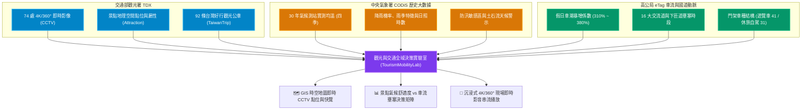
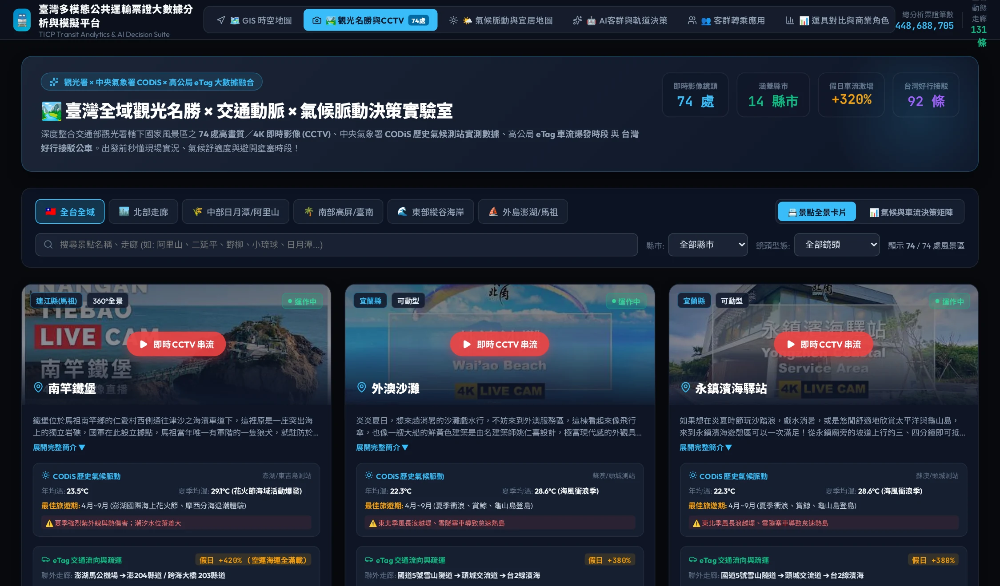
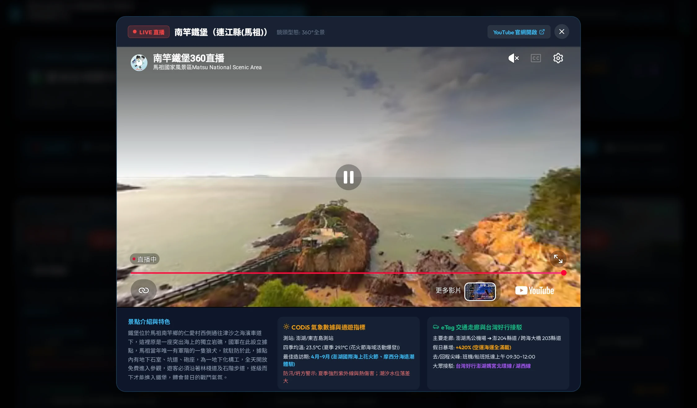
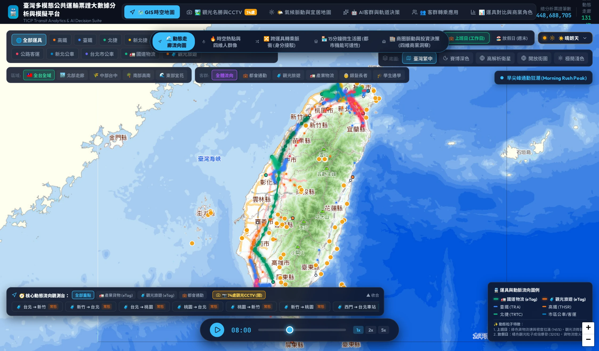

# 第九章：全台觀光名勝、景點即時影像 (CCTV) 與假日疏運大數據——山海脈動與即時旅運決策

🌐 **語言切換 / Language**: [ 🇹🇼 繁體中文 ] | [ 🇬🇧 English Version ](en/chapter9_tourism_mobility_cctv.md)

> 「平日的國道是產業物流與跨城通勤的鋼鐵動脈；假日的公路則是兩千三百萬人奔向山海與自然的情感奔流。當高鐵抵達端點、下匝道車流湧出，如何透過即時影像與氣候大數據，掌握全島的觀光脈動？」

---

## 9.1 觀光流動的本質：從「剛性收斂」到「假日爆發與山海發散」

在本書前幾章中，我們深入剖析了由都會通勤（雙尖峰、向心收斂）與國道產業物流（平日白天全線奔馳）構成的「剛性移動骨架」。然而，台灣島嶼地形多樣，高山與海洋僅一步之遙，造就了極為特殊的**「觀光旅遊時空潮汐」**：

1. **爆發性車流倍率（+280% ~ +420%）**：
   - 與平日平緩的基期相比，每逢週末與連假，國道 5 號（雪山隧道）、國道 6 號（南投埔里/日月潭）、國道 3 號南州段（往恆春/墾丁）與台 18 線（阿里山公路）之車流量平均飆升至平日的 **3.2 倍**，外島澎湖航運與空運更達 **4.2 倍** 之多。
2. **全日高原式壅塞與單向潮汐**：
   - 都會通勤的尖峰通常集中於早晨 07:30~09:00 與傍晚 17:30~19:00。
   - 觀光旅遊則呈現「去程午前高原（08:30~13:00）」與「返程午後漫長延滯（14:30~21:00）」，且受國道高乘載管制、匝道儀控與山區單線管制強烈約束。
3. **極高度的天候敏感度（Weather Sensitivity）**：
   - 觀光行程對天候的依賴遠超通勤。一場午後雷陣雨或東北季風長浪，會即時改寫外澳衝浪客、合歡山賞雪客或澎湖跳島旅客的流動方向。

為了讓決策者與旅運規劃者不再依賴事後統計或主觀猜測，本平臺在 **v1.3.0** 實現了**「TDX 觀光大數據 × 中央氣象署 CODiS 歷史氣候測站 × 觀光署 74 處 4K/360° 即時影像 (CCTV) × 高公局 eTag 假期疏運」**的國家級四維融合架構。

---

## 9.2 跨源融合架構：觀光署 CCTV、CODiS 氣象與交通動脈

### 資料源規格對齊表

| 構面 | 數據源 | 涵蓋規模 | 核心欄位與指標 |
| :--- | :--- | :--- | :--- |
| **現場實況 (Live Sight)** | 交通部觀光署 TDX 即時影像服務 | 全台 74 處國家風景區 | `Location`, `LiveURL`, `IFrameURL`, `ViewType` (360°全景/可動型/固定視角), `Status` |
| **氣候脈動 (Climate Pulse)** | 交通部中央氣象署 CODiS | 鄰近 30 年實測測站 | 四季均溫、夏季避暑舒適度、年均降雨日數、最佳造訪期、土石流與強風浪警示 |
| **交通動脈 (Mobility Arteries)** | 高公局 eTag + 台灣好行 | 111 條動態走廊、92 條好行路線 | 關鍵聯外道路（如台18、國5、台11）、假期暴增倍率、去回程尖峰時段、高鐵/台鐵轉乘 |

*圖 9-1：全台 74 處觀光名勝、即時影像 (CCTV) 與氣候交通脈動全景看板（涵蓋六大分區、CODiS 歷史適遊期、eTag 假日車流爆發比與台灣好行接駁）*

---

## 9.3 全台六大風景區聚落之移動特徵深入解剖

*圖 9-2：現場 4K / 360° 全景即時影音串流播放視窗（免廣告 YouTube 直播、現場天候與路況接駁側欄）*

### 一、 嘉義阿里山高山雲海走廊（11 處即時影像）
* **代表景點**：二延平步道、太平雲梯、奮起湖老街、生力農場、里佳資訊站、牛埔仔大草原。
* **CODiS 氣候特徵**：阿里山測站（海拔 2213m），年均溫僅 11.8°C，夏季平均 14.5°C，為全台頂級避暑聖地；秋冬乾燥涼爽，雲海與夕照能見度最高。
* **eTag 交通動脈**：國道 3 號中埔交流道 ➔ 台 18 線阿里山公路。週末車流暴增 **+340%**，去程尖峰為 08:30~11:30，午後山區易起濃霧，回程自 14:00 起湧現下山車潮。
* **大眾運輸推薦**：高鐵嘉義站／台鐵嘉義站搭乘「台灣好行阿里山線（7322 / 7329）」，享有優先路權並免受山路開車疲憊。

### 二、 南投日月潭水陸空休閒聚落（7 處即時影像）
* **代表景點**：伊達邵碼頭、文武廟、九蛙疊像、金龍山日出、慈恩塔、達克拉哈水上自行車道。
* **CODiS 氣候特徵**：日月潭測站（海拔 1015m），年均溫 19.5°C，水氣豐沛，秋季（9~11月）最為宜人，為泳渡與國際花火音樂嘉年華旺季。枯水期則可見九蛙疊像露底作為全台乾旱指標。
* **eTag 交通動脈**：國道 3 號霧峰系統 ➔ 國道 6 號愛蘭交流道 ➔ 台 21 線。假日車流達平日 **3.1 倍**，愛蘭交流道下匝道中午前常態回堵。
* **大眾運輸推薦**：高鐵台中站搭乘「台灣好行日月潭線（6670）」，到站直結日月潭水社碼頭與環湖公車（6669）。

### 三、 東北角、北海岸與宜蘭海岸衝浪廊道（15 處即時影像）
* **代表景點**：外澳沙灘（望龜山島）、野柳地質公園、福隆海水浴場、中角灣、老梅綠石槽、鼻頭服務區。
* **CODiS 氣候特徵**：富貴角與蘇澳測站，年均溫 22.1°C。冬季東北季風盛行（迎風面雨量密集），夏季則為衝浪與戲水天堂；老梅綠石槽更為每年 3~5 月限定景觀。
* **eTag 交通動脈**：國道 5 號雪山隧道 ➔ 頭城交流道 ➔ 台 2 線濱海公路。假日時段雪隧南下週六晨間大回堵、週日北上午後排隊長達 8 公里，車流量暴增 **+380%**。
* **大眾運輸推薦**：搭乘台鐵宜蘭線區間快車直達頭城/外澳站，或利用台灣好行壯圍沙丘線（綠18）與皇冠北海岸線（716）。

### 四、 東部縱谷海岸與綠島離島（14 處即時影像）
* **代表景點**：三仙台跨海大橋、加路蘭遊憩區、金樽衝浪遊憩區、鹿野高台（國際熱氣球節）、六十石山金針花海、石梯坪、綠島帆船鼻。
* **CODiS 氣候特徵**：成功與台東測站，年均溫 23.8°C，為全台少數終年無冬之溫暖海洋氣候。夏秋之際須關注太平洋颱風登陸第一線強風長浪。
* **eTag 交通動脈**：台 9 線縱谷公路與台 11 線海岸公路。連假期間跨城自駕旅運爆發 **+260%**。
* **大眾運輸推薦**：搭乘台鐵東部幹線（新自強號 3000）至台東站，轉乘「台灣好行東部海岸線（8101A）」或玉長豐濱線。

### 五、 高屏山海與小琉球珊瑚礁海島（10 處即時影像）
* **代表景點**：小琉球花瓶岩、望海亭、大福西漁港、茂林遊一區、賽嘉飛行傘起飛場、六龜彩虹山大佛。
* **CODiS 氣候特徵**：恆春測站，年均溫 25.2°C（熱帶氣候），冬季平均高達 21°C，為全台首屈一指的冬季避寒勝地；夏季午後受西南氣流熱對流影響明顯。
* **eTag 交通動脈**：國道 3 號南州交流道 ➔ 台 1 線 ➔ 台 26 線。假日車流激增 **+350%**，東港碼頭東琉線接駁船班每逢假日全開。
* **大眾運輸推薦**：高鐵左營站直達「台灣好行大鵬灣琉球線（9127D）」至東港碼頭，搭乘快艇 20 分鐘抵達小琉球。

### 六、 外島澎湖與連江馬祖（6 處即時影像）
* **代表景點**：澎湖北寮摩西分海、北寮風景區、隘門沙灘、菓葉觀日樓、七美南滬港碼頭、馬祖南竿鐵堡。
* **CODiS 氣候特徵**：澎湖年均雨量僅 1,000mm（蒸發量大於降雨量），4~9 月陽光充沛適遊；10月至翌年 2 月受東北季風強吹，外海風浪達 8~10 級。
* **交通動脈**：空運（松山/台中/高雄直飛）與海運（布袋港快艇）。假期海空運載客率達 **100% 滿載（+420%）**。

---

## 9.4 系統互動實戰：如何使用「觀光名勝與 CCTV」決策看板

*圖 9-3：GIS 時空動態流向地圖中的 74 處觀光景點 CCTV 圖層聯動（金色相機錨點、假期車流激增比與即時預覽）*

### 【🛠️ 互動操作步驟】
1. **點擊頂級導航標籤**：於平臺頂部點擊 **「🏞️ 觀光名勝與CCTV」**。
2. **切換區域與篩選**：
   - 點選上方區域按鈕（如：`🌾 中部日月潭/阿里山`、`🌊 東部縱谷海岸`、`⛵ 外島澎湖/馬祖`）。
   - 亦可依「縣市」或「鏡頭型態（可動型 PTZ / 360°全景 / 固定視角）」進行深度過濾。
3. **查閱三柱融合卡片**：
   - 每個卡片均整合了 **TDX 觀光景點介紹**、**CODiS 測站四季溫度與最佳旅遊期**，以及 **eTag 假日車流爆發比與台灣好行接駁**。
4. **一鍵開啟現場即時串流**：
   - 點擊卡片中央的紅鈕 **「▶️ 現場即時 CCTV 串流」**，系統將以暗黑玻璃擬態（Glassmorphism）彈出高畫質 YouTube Live 直播視窗，讓您即時查看山區雲海起伏、海灘人潮與公路天候！
5. **在 GIS 時空地圖中聯動**：
   - 切換回 **「🗺️ GIS 時空地圖」**，於上方控制條點擊 **「📷 74處觀光CCTV (開)」**，地圖上即會浮現全台景點相機標記，點擊即可開啟地圖即時預覽彈出窗！

---

## 9.5 本章結語與政策決策意涵

透過將 **即時影像串流（視覺實證）**、**氣候數據庫（長期環境規律）** 與 **車流大數據（路網承載力）** 緊密結合，我們實現了觀光決策的三大典範轉移：
1. **旅運者端的「聰明預判」**：出發前不只看氣象預報，更透過 CCTV 實景查證「太陽出來了沒、雲海浮現了嗎」，並依據 eTag 尖峰預報選擇提早出發或搭乘台灣好行。
2. **管理機關端的「智慧疏導」**：國家風景區管理處可結合停車場飽和度、下匝道車流與即時人潮，即時啟動台 18 線或台 2 線之動態接駁與高乘載警示。
3. **綠色運具的「誘因定錨」**：透過展示 TPASS 與台灣好行的無縫接駁，引導觀光客將自駕車輛留在高鐵/台鐵樞紐，達成觀光熱區之減碳與永續經營目標。

---
👉 **[返回全書導讀目錄 (README)](README.md)**
