# 📚 Taiwan Mobility Pulse: The Master Guide to National Multi-Modal Mobility & Spatial Intelligence
### 國家級公共運輸票證與高速公路車流大數據全景指南

🌐 **Language Switcher / 語言切換**: [ 🇬🇧 English ] | [ 🇹🇼 繁體中文版 ](../README.md)

> *"The breathing of a city is inscribed in the card swipe records of the morning's first metro train; the pulse of a nation beats beneath the wheels of heavy freight trucks rushing along national freeways at midnight."*

> 📥 **Full Master Monograph**: This guide has been compiled into a publication-grade interactive monograph (featuring 9 macro chapters, full-color data schemas, multi-dimensional comparison matrices, and direct teleportation portals):  
> 👉 **[Download English Master Monograph PDF (v1.3.0 Scenic CCTV & Tourism Edition)](taiwan_mobility_pulse_guidebook_en.pdf)** | **[🇹🇼 Traditional Chinese PDF](../taiwan_mobility_pulse_guidebook.pdf)**

---

## 📖 Preface: Why Do We Need an "Interactive Monograph"?

Historically, transportation and urban mobility big data projects have often fallen into two extremes:

1. **Extreme 1: Cold, Opaque Statistical Reports**  
   Filled with impenetrable Origin-Destination (OD) tables, static matrices, and hundreds of pages of unnavigable PDFs. They lack spatial vitality—decision-makers cannot intuitively experience the temporal rhythms and territorial tides of human mobility.
2. **Extreme 2: Dazzling yet Superficial Command Dashboards**  
   Floating neon particles and pulsing glow points offer a futuristic visual spectacle, but fail to answer fundamental analytical questions: **"Why were these datasets selected?", "What is the physical ground truth behind these numbers?", and "How do these data sources strictly exclude and complement one another?"**

**Taiwan Mobility Pulse** was created to bridge this chasm. By fusing **448 million real ticket transactions from MOTC TICP**, **millions of eTag freeway gantry vehicle observations from Freeway Bureau**, **real-time TDX parking and civic infrastructure APIs**, **30 years of continuous microclimate historical observations from CWA CODiS**, and **strategic cellular signaling frameworks**, we have synthesized a publication-grade interactive monograph.

This guide serves as your comprehensive chapter roadmap, leading you step-by-step through the most compelling mobility dynamics on the island of Taiwan. Every chapter includes **dedicated interactive map teleportation links** and **hands-on operational highlights**, enabling you to read, click, and verify in real time!

---

## 🗺️ Master Table of Contents & Navigation Map

```mermaid
flowchart TD
    classDef default fill:#1e293b,stroke:#38bdf8,stroke-width:1.5px,color:#f8fafc,padding:16px 50px;

    C1["&emsp;Chapter 1: Data Philosophy & Architectural Selection&emsp;<br/>&emsp;(Rigid Skeleton vs. Flexible Muscle)&emsp;"] --> C2["&emsp;Chapter 2: National Data Foundation & Entity Schemas&emsp;<br/>&emsp;(Time Horizons, Field Dictionaries & CODiS Specs)&emsp;"]
    C2 --> C3["&emsp;Chapter 3: Intercity Arteries & Urban Mobility Corridors&emsp;<br/>&emsp;(111 Dynamic Corridors & Passenger/Freight Tides)&emsp;"]
    C3 --> C4["&emsp;Chapter 4: Hotspot Radiation & Off-Ramp Catchment Halos&emsp;<br/>&emsp;(eTag Flow Injection & Parking Pressure Interlocking)&emsp;"]
    C4 --> C5["&emsp;Chapter 5: Four Micro-Personas & Weather Sensitivity&emsp;<br/>&emsp;(Who Moves? How Rain Reshapes Commuting Routes)&emsp;"]
    C5 --> C6["&emsp;Chapter 6: Islandwide Climate Pulse & Microclimate Livability&emsp;<br/>&emsp;(30-Year Variations, Extreme Rankings & 12-Month Tides)&emsp;"]
    C6 --> C7["&emsp;Chapter 7: Commercial Pulse & Station Hub Intelligence&emsp;<br/>&emsp;(TOD Catchments, EV Supercharging & Retail Grab-and-Go)&emsp;"]
    C7 --> C8["&emsp;Chapter 8: National Multi-Source Data Fusion Strategy&emsp;<br/>&emsp;(Door-to-Door Closed Loop & Policy Selection Matrix)&emsp;"]
    C8 --> C9["&emsp;Chapter 9: Scenic Tourism, Live CCTVs & Holiday Traffic Dispersal&emsp;<br/>&emsp;(74 4K/360° Live Feeds, Mountain-Coast Pulses & Smart Travel)&emsp;"]
```

### 📑 Chapter Overviews

* **[Chapter 1: Data Philosophy & Architectural Selection — Why "Rigid Skeleton + Flexible Muscle"?](chapter1_data_philosophy.md)**
  * An in-depth critique of relying solely on coarse cellular signaling. Explains why TICP ticket transactions and eTag freeway flows serve as the zero-drift physical ground truth. Analyzes identity truth labels, natural mutual exclusivity, and double-counting mitigation.
* **[Chapter 2: National Data Foundation & Entity Schemas — TICP, eTag, TDX, and CODiS Specifications](chapter2_data_dictionary_and_samples.md)**
  * Deconstructs 448 million ticketing records, 325 eTag gantries, TDX parking APIs, and CWA CODiS 30-year climatological datasets. Explains physical field definitions, temporal granularities, salted hash de-identification, and real JSON samples.
* **[Chapter 3: Intercity Arteries & Urban Mobility Corridors — 111 Dynamic Flow Corridors](chapter3_flow_arteries.md)**
  * Maps High-Speed Rail (THSR), Taiwan Railway (TRA), 5 major metro systems, industrial tech freight corridors (Hsinchu Science Park, International Ports), and scenic highways. Analyzes weekday peak commuting vs. weekend migration tides.
* **[Chapter 4: Hotspot Radiation & Off-Ramp Catchment Halos — eTag Flow Injection & Parking Pressure](chapter4_etag_halos_heatmap.md)**
  * Introduces the groundbreaking "Off-Ramp Discharge Catchment Halos". Traces vehicle dispersion into local urban grids across 16 strategic interchanges and proves strong correlation with TDX real-time parking lot occupancy.
* **[Chapter 5: Four Micro-Personas & Weather Sensitivity — Who Moves? How Weather Reshapes Routes](chapter5_personas_weather.md)**
  * Constructs four personas: Iron Commuters, Active Seniors, Gen-Z Students, and Weekend Tourists. Features the Weather Simulation Lab, revealing how storms induce a sharp plunge in cycling/bus trips while underground rail proves resilient.
* **[Chapter 6: Islandwide Climate Pulse & Microclimate Livability — 30-Year Variations & Seasonal Tides](chapter6_climate_pulse.md)**
  * Interfaces with 30 years of CWA CODiS data. Unveils the Taipei basin +0.8°C heat island, precipitation condensation into intense cloudbursts, dehumidifier 24/7 overload rankings (Anbu 98, Linkou 77), natural typhoon shelters (Taichung 85), and a 12-month interactive climate player.
* **[Chapter 7: Commercial Pulse & Station Hub Intelligence — TOD Catchments, EV Charging & Retail](chapter7_commercial_pulse.md)**
  * Elevates transit nodes into TOD commercial lifestyle anchors. Empirically evaluates Taiwan's Top 30 transit hubs, linking customer spending propensity, EV 360kW supercharger gap radars, and grab-and-go meal peak hours.
* **[Chapter 8: National Multi-Source Data Fusion Strategy — Door-to-Door Closed Loop & Policy Matrix](chapter8_data_fusion_strategy.md)**
  * Formulates the "1 + 1 + 1 > 3" Door-to-Door full-day travel closed loop. Details the pioneering inverse calibration algorithm using hard ticketing/eTag anchors to rectify cellular signaling expansion bias, followed by a procurement decision matrix.
* **[Chapter 9: Scenic Tourism, Live CCTVs & Holiday Traffic Dispersal — Real-Time Travel Intelligence](chapter9_tourism_mobility_cctv.md)**
  * Fuses MOTC Tourism Administration's 74 4K/360° scenic live CCTVs, CWA CODiS climatology, Freeway eTag holiday surge multipliers (+320%), and 92 TaiwanTrip bus routes into a 4D decision framework for real-time crowd inspection, weather comfort, and congestion bypass.

---

## 🎯 Interactive Map Quick Index

Clicking the hyperlinked portals below opens the live web application in a new browser tab, automatically navigating to the corresponding interactive laboratory:

| Chapter Theme | Core Analytical Concept | Live Web App Portal (Click to Open) | Key Highlights to Explore |
| :--- | :--- | :--- | :--- |
| **Ch 1** Data Philosophy | Drift contrast, identity truth, mutual exclusivity | [👉 Three-Source Strategic Matrix](https://tobytoy.github.io/taiwan-mobility-pulse/#telecom) | Inspect the Master Table 3-way matrix; compare pre-processing and audit costs |
| **Ch 2** Data Dictionary | 448M census baseline, field schemas, raw samples | [👉 Data Foundation & Dictionary Matrix](https://tobytoy.github.io/taiwan-mobility-pulse/#telecom) | Review real JSON payloads for TICP ticketing, eTag 5 vehicle classes, and CODiS weather |
| **Ch 3** Corridors | 111 flow particle streams, freight vs. tourism | [👉 Dynamic Flow Corridors Map (FlowMap)](https://tobytoy.github.io/taiwan-mobility-pulse/#flows) | Toggle between "Workday" and "Weekend"; drag timeline to observe Hsinchu & Hsuehshan tides |
| **Ch 4** Off-Ramp Halos | 16 strategic interchanges, TDX parking pressure | [👉 Spatiotemporal Heatmap & Catchment Halos](https://tobytoy.github.io/taiwan-mobility-pulse/#heatmap) | Turn on "🛣️ eTag Interchange Halos", click "Ailan / Sun Moon Lake" to see parking strain |
| **Ch 5** Personas & Weather | 4 micro-personas, Sunny vs. Torrential Rain | [👉 Micro-Personas & Weather Simulation Lab](https://tobytoy.github.io/taiwan-mobility-pulse/#personas) | Select "Active Seniors", switch to "Torrential Rain", observe elderly trip drop-off |
| **Ch 6** Climate Pulse | 30-year trends, extreme rankings, 12-month tides | [👉 Climate Pulse & Livability Lab](https://tobytoy.github.io/taiwan-mobility-pulse/#climate-lab) | Activate "12-Month Seasonal Player", observe monthly temperature swings and mold index |
| **Ch 7** Commercial Pulse | Top 30 transit hubs, EV supercharging gaps | [👉 Commercial Pulse & Station Intelligence](https://tobytoy.github.io/taiwan-mobility-pulse/#commercial-lab) | Select "Taipei Main Station" or "Banqiao" to view right HUD commercial diagnostics |
| **Ch 8** Global Fusion | Door-to-Door 5-stage loop, hard anchor calibration | [👉 Multi-Source Fusion & Decision Guide](https://tobytoy.github.io/taiwan-mobility-pulse/#telecom) | Examine the Yonghe ➔ Neihu travel reconstruction and TOD enterprise selection guide |
| **Ch 9** Tourism & CCTV | 74 4K/360° live scenic feeds, holiday surge | [👉 Tourism Destinations & Live CCTV Dashboard](https://tobytoy.github.io/taiwan-mobility-pulse/#tourism) | Click "Live CCTV" to view mountain sea of clouds, CODiS best seasons & eTag surges |

---

## 💡 Reading & Exploration Recommendations

1. **Dual-Screen or Split-View Reading**: We recommend placing this guide on the left side of your screen and the interactive web application on the right. Verify empirical data on the map as you study the theoretical discourse.
2. **Follow the Practical Walkthroughs**: Each chapter contains step-by-step **【🛠️ Hands-on Operational Walkthroughs】** and **【🔍 In-Depth Data Takeaways】** to help you quickly identify hidden patterns across millions of records.
3. **Engage with Investigative Inquiries**: Ponder questions such as "Why does heavy freight account for 34% of traffic at Daya Interchange on weekday mornings?" or "Does heavy rain truly leave metro ridership unaffected?" Detailed empirical validations await within.

Ready to begin? Let us turn to Chapter 1 and uncover the foundational philosophy behind Taiwan's transportation data!  
👉 **[Proceed to Chapter 1: Data Philosophy & Architectural Selection](chapter1_data_philosophy.md)**
