# Chapter 10: Nationwide Historical Traffic Safety Big Data & A1 Fatal Blackspots Atlas: Spatial Conflicts, Weather Vulnerability, and Vision Zero

🌐 **Language / 語言切換**: [ 🇬🇧 English Version ] | [ 🇹🇼 繁體中文版 ](../chapter10_traffic_safety_blackspots.md)

> "The ultimate virtue of transportation lies not merely in 'how swiftly one arrives,' but in 'whether one returns home safely.' While high-speed rail, metros, and freeways knit our island with unmatched efficiency, do life-arteries, off-ramps, and unsignalized intersections conceal fatal micro-vortices? Only when data speaks spatially can Vision Zero anchor its geometric engineering and systemic policies."

---

## 10.1 The Essence of Traffic Safety: Moving from Macro Aggregate Counts to Spatial Blackspot Topologies

Taiwan has long grappled with severe road safety challenges, suffering thousands of fatalities and hundreds of thousands of injuries annually. Historically, public discourse often stagnated around abstract annualized fatality counts or moralistic appeals for driver vigilance, failing to answer decisive spatial and engineering questions:

1. **Where do fatal casualties cluster?** (Along grade-separated expressways, urban multi-lane arterials, or narrow unsignalized village corridors?)
2. **What micro-geometric attributes prove fatal?** (High-speed mid-block loss of control, four-way yellow-light side collisions, or intersection sightline blockages?)
3. **How does adverse weather amplify vulnerability?** (By what percentage does heavy downpour lengthen stopping distances? How severely does nighttime lack of illumination heighten pedestrian fatality?)

To resolve the fragmentation of traffic safety data across 22 regional police bureaus, the **v1.3.2** release of this platform integrates the **Ministry of Transportation and Communications (MOTC) TDX Historical Traffic Database (`TrafficAccident/A1T1`) and Standard Event Codebook (`TrafficEventCode`)**. We executed an exhaustive nationwide retrieval and digital decoding of all **1,339 A1 fatal traffic incidents (fatalities on-site or within 24 hours)** for the entire year of 2022 across all 22 administrative divisions of Taiwan, forging the nation's premier **Dynamic Corridor & Historical Blackspot Spatial Atlas**.

---

## 10.2 TDX Historical Traffic Safety Architecture & Digital Decoding Pipeline

```mermaid
flowchart TD
    classDef tdx fill:#0284c7,stroke:#38bdf8,stroke-width:2px,color:#fff;
    classDef decode fill:#d97706,stroke:#f59e0b,stroke-width:2px,color:#fff;
    classDef gis fill:#059669,stroke:#10b981,stroke-width:2px,color:#fff;
    classDef hud fill:#7c3aed,stroke:#c084fc,stroke-width:2px,color:#fff;

    subgraph S1["MOTC TDX Historical Database Gateway"]
        A1["22 Cities A1T1 Historical Endpoints (2022 Full Year)"]:::tdx
        A2["Traffic Safety Event Codebook (1,000 KeyID Dict)"]:::tdx
    end

    subgraph S2["Automated ETL & Decoding Engine (fetch_tdx_traffic_safety.py)"]
        B1["OAuth 2.0 Auth & Gateway Query Parameter Normalization"]:::decode
        B2["Weather Code Decoding (Clear / Cloudy / Rain / Torrential)"]:::decode
        B3["Illumination & Pavement Decoding (Day / Night Lit / Unlit)"]:::decode
        B4["Collision Pattern Resolution (Side / Angle / Rear-End / Pedestrian)"]:::decode
    end

    subgraph S3["Spatial Geospatial & Render Engine (FlowMap.jsx)"]
        C1["Leaflet Canvas 1,339 CircleMarker Layer"]:::gis
        C2["Severity Color Hierarchy (Multi-Death Red / Pedestrian Amber / Rain Cyan)"]:::gis
        C3["XSS-Sanitized Glassmorphism Detail Card (Popup)"]:::gis
    end

    subgraph S4["Real-Time Decision & Multi-Filter HUD (Right HUD)"]
        D1["4 Macro KPIs (Incidents / Deaths / Injuries / Rain Ratio)"]:::hud
        D2["Context Filter Pills (All / 🌧️ Rain / 🌙 Night / 🚶 Pedestrian / 🚗 Crash)"]:::hud
        D3["Top 4 Fatal Collision Topology Breakdown"]:::hud
        D4["Crosshair FlyTo Immediate Spatial Teleportation"]:::hud
    end

    A1 & A2 --> B1 --> B2 & B3 & B4 --> C1 & C2 & C3 --> D1 & D2 & D3 & D4
```



### Dataset Specification Matrix

| Dimension | Endpoint Source | Scale | Key Attributes & Decoded Outputs |
| :--- | :--- | :--- | :--- |
| **A1 Fatal Incidents** | `/v1/TrafficAccident/A1T1/{City}` | 22 Cities · 1,339 Records | `case_no`, `site` (precise address), `lat/lon` (WGS84), `time` (exact timestamp), `death` (fatalities), `injured` (injured counts), `speed_limit` (posted limit) |
| **Event Code Dictionary** | `/v1/AccidentBasic/TrafficEventCode` | 1,000 Integer KeyIDs | `WeatherCode` ➔ Weather label; `LightCode` ➔ Illumination condition; `AccidentPatternsCode` ➔ Collision topology; `RoadCategoriesCode` ➔ Hierarchy; `PavementConditionCode` ➔ Road surface state |
| **Corridor Overlay** | Mobility Arteries + CCTV | 114 Corridors, 74 Cameras | Vehicle volume surge, tourist dispersal flows overlaid with high-risk casualty blackspots |


*Figure 10-1: Nationwide 1,339 A1 Historical Fatal Blackspots Spatial Distribution & Right HUD Diagnostic Panel (Displaying 1,367 deaths, 571 injuries, and multi-dimensional filters)*

---

## 10.3 Empirical Anatomy of Nationwide Fatal Blackspots

Through cross-dimensional synthesis across all 1,339 incidents, the data illuminates three critical takeaways that directly challenge legacy planning assumptions:

### 1. Road Hierarchy: Nearly 70% of Fatalities Occur on Urban Arterials & Village Streets

Public intuition often assumes that high-speed freeways represent the deadliest environments. Spatial data radically disproves this myth:

* **Urban Roads**: **687 cases (51.3%)**, ranking first nationwide.
* **Village & Rural Roads**: **245 cases (18.3%)**, ranking second.
* **Provincial Highways**: **210 cases (15.7%)**.
* **National Freeways**: Only **83 cases (6.2%)**.

> **Analytical Takeaway**: High-standard grade-separated freeways feature concrete center barriers, grade separation, and strict non-motorized vehicle exclusions, keeping total fatalities remarkably low. **69.6% of nationwide road fatalities concentrate within open local and urban street networks**, affirming that mixed-traffic conflicts, turning maneuvers, and unsignalized sightline blind spots constitute the true crisis.

---

### 2. Collision Topology Top 4: Side-Impacts and Intersection Conflicts Dominate


*Figure 10-2: Interactive Glassmorphism Blackspot Detail Popup upon Marker Selection (Decoded case number, location, speed limit, collision type, and casualty figures)*

Nationwide fatal crash geometries exhibit an acute concentration in intersection conflict patterns:

| Rank | Collision Topology | Cases | Share | Fatal Mechanism & Spatial Blindspot |
| :---: | :--- | :---: | :---: | :--- |
| **1** | **Vehicle-to-Vehicle Side Impact** | **245** | **18.3%** | Failure to yield at minor-major intersections, acute sight triangle obstruction, direct lateral strikes (minimal side-impact cabin crumple zone). |
| **2** | **Vehicle-to-Vehicle Angle Crossing** | **151** | **11.3%** | Signal running (yellow/red light racing), unsanctioned left turns ahead of oncoming traffic, conflict between direct flow and two-stage turning bikes. |
| **3** | **Vehicle-to-Vehicle Rear-End** | **115** | **8.6%** | Failure to maintain safe following distance, distracted driving (mobile device use), sudden tail-end braking on congested arterials. |
| **4** | **Pedestrian Crossing Collisions** | **111** | **8.3%** | Unlit or unrefuged zebra crossings, vehicle A-pillar blind spots during turning, vulnerable senior pedestrians traversing multi-lane unsignalized roads. |
| **5** | **Single Vehicle Fixed-Object Strikes** | **155** | **11.5%** | Excessive speed on suburban curves, driver fatigue, unshielded roadside utility poles and guardrails. |

---

### 3. Weather & Lighting Vulnerability: Rainfall Penalty & Nighttime Blind Spots


*Figure 10-3: Spatial Blackspot Map Filtered by '🌧️ Rain Weather (177 Cases)' (Demonstrating fatal rain crash clustering on urban transit arterials and suburban connectors)*

* **Rain Weather Incidents**: **177 cases (13.2% of all fatal accidents)**.
  - Precipitation degrades tire traction, extending braking distance by 30% to 40%, while severely deteriorating windshield and mirror visibility.
  - Data verifies: Under precipitation, **side-impact angle collisions and turning pedestrian strikes** escalate substantially in lethality, especially on perimeter arterials carrying peak suburban commuter traffic.
* **Nighttime & Low Illumination**:
  - Lighted Night: **411 cases (30.7%)**; Unlit Night: **56 cases (4.2%)**; Dawn/Dusk: **65 cases (4.9%)**.
  - Non-daylight hours collectively account for **532 cases (39.7%)**. On unlit rural corridors, pedestrians crossing in dark clothing face almost zero driver reaction buffer.

---

## 10.4 Practical Operational Walkthrough in Web App

This platform embeds traffic safety intelligence directly within the primary Dynamic Flow Map:

```
[User Exploration Workflow]
Navigate to Home Map ➔ In bottom strip "🧭 Core Corridor Radar"
➔ Click "⚠️ 1,339 Safety Blackspots (Toggle On)"
➔ 1,339 fatal blackspots illuminate across Taiwan; Right HUD drawer expands
➔ Select context filters: "🌧️ Rain (177)" or "🚶 Pedestrian (182)"
➔ Click any marker on map to open decoded card ➔ Click "📍 Teleport" to zoom to intersection
```

### Visual & Interactive Highlights
1. **Color Psychology & Risk Tiers**:
   - Multiple-fatality crashes (≥2 deaths) styled with **Crimson Halo (`#DC2626`)**;
   - Pedestrian involvements highlighted in **Warning Amber (`#F59E0B`)**;
   - Rainy crashes highlighted in **Meteorological Cyan (`#38BDF8`)**;
2. **Spatiotemporal Corridor Overlay**:
   - Toggle "🚛 Freight Logistics" or "🧳 Tourism Dispersal" corridors simultaneously to examine where high-volume off-ramp vehicular torrents coincide with documented urban blackspots.

---

## 10.5 Policy Recommendations: Data-Driven Spatial Interventions for Vision Zero

The spatial atlas constructed in this chapter furnishes transport authorities, urban planners, and enforcement bodies with four actionable pathways:

1. **Geometric Intersection Redesign**:
   - For side-impact collisions (18.3%), enforce **curb extensions (bulb-outs), sight triangle clearance, and mini-roundabouts or raised crosswalk tables**, physically decelerating vehicles through high-conflict junctions.
2. **Dedicated Pedestrian Refuge Islands**:
   - For pedestrian fatalities (8.3%), mandate **raised mid-road refuge islands (≥1.5m width)** on all arterials exceeding four lanes, paired with **Leading Pedestrian Intervals (LPI)** to eliminate turning conflicts.
3. **Weather-Responsive Dynamic Speed Governance**:
   - Fuse Central Weather Administration (CWA) precipitation data with dynamic speed signage on rain-prone corridors, automatically dropping limits from 60 km/h to 40 km/h during downpours and broadcasting variable following-distance alerts.
4. **TPASS-Driven Mode Shift to Mitigate Exposure Risk**:
   - Empirical safety science proves that public transit (rail, metro, city bus) presents a casualty rate hundreds of times lower per passenger-kilometer than private motorcycles and cars. Expanding TPASS regional transit integration represents the ultimate structural countermeasure to lower baseline casualty exposure nationwide.

---

👉 **[Back to Guidebook Index](README.md)** | **[Proceed to Chapter 9: Tourism, CCTVs & Holiday Dispersal](chapter9_tourism_mobility_cctv.md)**
