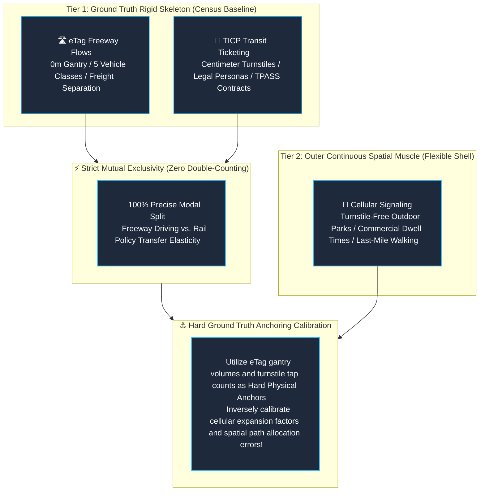

# Chapter 1: Data Philosophy & Architectural Selection — Why "Rigid Skeleton + Flexible Muscle"?

🌐 **Language Switcher / 語言切換**: [ 🇬🇧 English ] | [ 🇹🇼 繁體中文版 ](../chapter1_data_philosophy.md)

> *"In the realm of data science, vast volume does not equate to precision. If baseline coordinates are adrift and human identities are mere conjectures, even the most elaborate neural network merely magnifies spatial illusions."*

---

## 1.1 The Eternal Dilemma of Big Data in Mobility: Noise & The Cost of Estimation

Over the past decade, intelligent transportation and human mobility analytics have frequently faltered due to a single blind spot: **unquestioned reliance on a single data source**.

Numerous initiatives attempted to solve all urban problems exclusively using **Cellular Signaling Data**: from metro ridership and street congestion to commercial district expenditure. However, when projects entered the stages of government audits, formal acceptance, or granular civil engineering, glaring discrepancies inevitably emerged:

* **Why were passengers standing on an underground platform 3 levels deep misclassified by cellular towers as driving cars on the elevated viaduct overhead?**
* **Why could statistical expansion figures generated from cellular signaling never be legally utilized to disburse billions of New Taiwan Dollars in government TPASS budget subsidies?**
* **Why, after an individual lingered continuously in a neighborhood for 8 hours, remained impossible to discern whether they were an office professional, a student, or an international tourist?**

The genuine hurdle in mobility data science has never been "whether the data volume is sufficiently large," but rather **the intrinsic physical and legal attributes of the data engineering pipeline**.

From its inception, this project established an uncompromising foundational philosophy:  
**"Anchor the baseline with zero-drift physical ground truth as the rigid skeleton, and drape continuous territorial coverage over it as the flexible muscle."**

---

## 1.2 Why Choose TICP Public Transit Ticketing? (Centimeter-Level Rigid Ground Truth)

We adopted over **448 million records of real electronic ticketing transactions** from the Ministry of Transportation and Communications (MOTC) TICP platform as the core public transit foundation of this research. Its irreplaceable value manifests across three absolute dimensions:

1. **100% Physical Full Census (Census Baseline, Non-Sample Expansion)**:  
   Every tap at a turnstile or bus farebox represents a physical legal and financial transaction. There is no synthetic statistical inflation factor (such as multiplying market share by 2.7×). The data represents the exact, unadulterated physical passenger count.

2. **Statutory Personas & Contractual Ground Truth**:  
   Every ticketing record inherently carries a legally validated identity attribute:
   * `TicketType=4`: **TPASS Commuter Monthly Pass** (heavy regular commuters directly benefiting from national transit policies).
   * `TicketType=03/04`: **Senior & Concession Cards** (citizens aged 65+ or persons with disabilities receiving statutory municipal subsidies).
   * `TicketType=02`: **Student Cards** (middle, high school, and university students exhibiting distinctive morning drop-off and after-school cram school travel cycles).
   * `Single-Journey Token / Mobile QR`: **International tourists, leisure travelers, or occasional users**.  
   Identities are objective legal facts, requiring zero probabilistic guesswork from machine learning classifiers.

3. **Centimeter-Level Platform & Vertical Height Precision (Z-Axis Truth)**:  
   Fare turnstiles are physically bolted onto underground basement levels (B2, B3) or elevated platform structures. Regardless of severe urban canopy occlusion or multi-tier viaduct stacking, a turnstile tap establishes with 100% certainty that the passenger is physically inside the rapid transit system, eliminating elevation ambiguity.

---

## 1.3 Why Choose eTag Freeway Traffic Flows? (0m Gantry Freight & Passenger Separation)

For highway corridors and intercity travel, we integrated millions of freeway vehicle passage records from the Freeway Bureau's electronic toll collection (eTag) network:

1. **0m Gantry Precision with Zero Spatial Drift**:  
   eTag microwave sensor gantries are mounted at fixed, precisely measured highway kilometer posts (e.g., National Freeway 1, Kilometer 23.4k). A vehicle detection event is tied to an invariant coordinate. Data processing requires only temporal timestamp normalization, eliminating the massive computational overhead of road-network map-matching.

2. **Classification Across 5 Statutory Vehicle Categories (The Lifeblood of Freight)**:  
   The eTag infrastructure categorizes every passage based on official motor vehicle registration and axle counts into 5 statutory classes:
   * `Class 31`: Small Passenger Cars (private commuting, family outings).
   * `Class 32`: Small Freight Trucks (urban light logistics, plumbing/electrical trade vans).
   * `Class 41`: Large Passenger Buses (intercity coaches, tour buses).
   * `Class 42`: Heavy Freight Trucks (intercity arterial trunk freight).
   * `Class 51/52`: Articulated / Semi-Trailer Container Trucks (international seaports, petrochemicals, heavy steel).  
   This illuminates Taiwan's real "industrial logistics skeleton"—a critical economic domain that transit ticketing cannot capture.

3. **Natural Mutual Exclusivity with Ticketing**:  
   An individual cannot physically be driving a personal vehicle on a national freeway while simultaneously swiping a card inside an underground metro train at the exact same second. Therefore:
   $$\text{Total Intercity Corridor Flow } Q_{\text{Total}} = Q_{\text{eTag (Freeway Auto/Freight)}} + Q_{\text{Ticket (Rail/Transit)}}$$
   **These two streams can be added directly together with zero double-counting**, establishing the cleanest gold standard for calculating **Modal Split**.

---

## 1.4 Why Integrate TDX Parking and Urban Functions?

Vehicles do not vanish into thin air upon descending an off-ramp.  
When highway traffic pours into local arterial surface grids, the immediate shockwaves are absorbed by **local parking infrastructure capacity** and **commercial service networks**.

By interconnecting MOTC TDX real-time parking APIs and urban point-of-interest densities (EV chargers, convenience stores, hypermarkets) with interchange discharge flows, we seamlessly translate macro highway volumes into micro-scale urban carrying capacity indicators.

---

## 1.5 Limitations of Cellular Signaling: Spatial Drift, UID Scrambling, and Double-Counting

While cellular signaling offers comprehensive geographic coverage, it presents three severe vulnerabilities in transportation engineering:

1. **Spatial Drift & Ping-Pong Handover**:  
   Cell tower coverage radii in urban areas span 200m to 500m. When a user is stationary inside a high-rise, their mobile phone frequently switches associations between neighboring base stations. Algorithms easily misinterpret this jitter as high-speed movement. When elevated viaducts run directly above underground subway tunnels, cell towers cannot resolve the user's vertical elevation.

2. **Privacy Hash Rotations Fragmenting Trip Chains**:  
   To comply with privacy regulations, telecommunications operators periodically scramble temporary pseudonymous identifiers (IMSI / temporary UIDs) on a daily or weekly basis, injecting stochastic spatial perturbation noise. **Once UIDs are randomized, tracking multi-week longitudinal trip chains becomes impossible**, erasing the distinction between loyal local commuters and one-off visitors.

3. **Severe Vehicle Cabin Double-Counting**:  
   When passengers ride an underground metro train, cellular towers detect hundreds of mobile devices and apply a ~2.6× expansion factor. Simultaneously, metro faregates record every tap. If cellular estimates are added directly to ticketing records without calibration, **metro passenger volumes are dramatically inflated**. Deduplicating them without plain-text identity linkages requires probabilistic assumptions, introducing secondary estimation errors.

---

## 1.6 Strategic Paradigm: "Rigid Skeleton + Flexible Muscle" Three-Source Fusion

Synthesizing these empirical realities, this project established the national-level multi-source data fusion framework:

*Figure 1.1: Live Application Interface — Three-Source Strategic Master Matrix illustrating the four core evaluation dimensions (Spatial Stability, Identity Contracts, Mutual Exclusivity, and Double-Counting Mitigation).*

---

## 1.7 🛠️ Hands-on Operational Walkthrough: Navigating the System

To experience the Three-Source Strategic Master Matrix firsthand, follow these steps:

* **[👉 Launch Live Application: Data Strategy Master Matrix](https://tobytoy.github.io/taiwan-mobility-pulse/#telecom)**

### Operational Steps:
1. Click the link above or click **【Telecom vs. Ticketing】** on the top navigation bar.
2. The system defaults to **【🛡️ Act I: Strategic Master Matrix & Core Dimension Duel】**.
3. Review the four comparative duel cards (Spatial Physical Stability, Statutory Persona Contracts, Mutual Exclusivity, Activity Coverage & Redundancy).
4. Scroll down to inspect the **"Comprehensive Multi-Dimensional Cross-Comparison Table"**, contrasting 8 analytical indicators across eTag, TICP ticketing, and cellular signaling.

---

## 1.8 🔍 Core Data Takeaways & Analytical Inquiries

> **💡 Thought Inquiry**:  
> When government auditors evaluate whether the NT$ 10 billion annual public expenditure on the "Executive Yuan TPASS 1200 Commuter Pass" was justified:
> * Can statistical estimates from cellular signaling be submitted to the Directorate-General of Budget, Accounting and Statistics for expenditure write-offs?  
>   *(No: cellular data lacks financial transaction ledgers, precise ticket class codes, and legal audit proofs.)*
> * Why must TICP ticketing big data serve as the bedrock?  
>   *(Because every single record represents an indelible, audited financial transaction.)*
> * Why is eTag integration indispensable?  
>   *(To substantiate whether private vehicle travel on parallel freeways truly decreased, and if so, exactly where that diverted traffic relocated.)*

Having anchored our foundational data philosophy, we now proceed to dissect the lowest-level database architectures, field definitions, and raw schema payloads in the next chapter!

👉 **[Proceed to Chapter 2: National Data Foundation & Entity Schemas](chapter2_data_dictionary_and_samples.md)**
