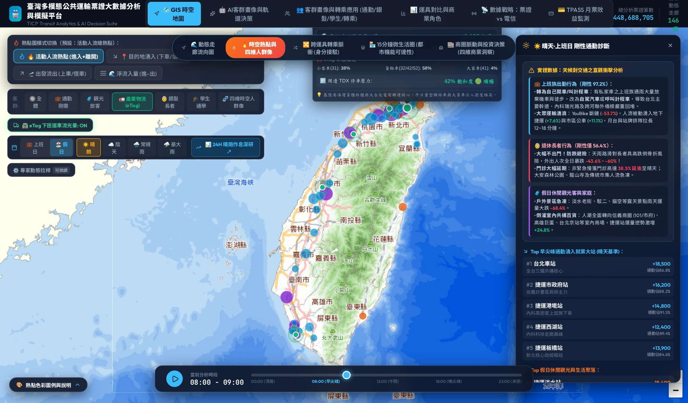

# Chapter 4: Hotspot Radiation & Off-Ramp Catchment Halos — eTag Flow Injection & Parking Pressure Interlocking

🌐 **Language Switcher / 語言切換**: [ 🇬🇧 English ] | [ 🇹🇼 繁體中文版 ](../chapter4_etag_halos_heatmap.md)

> *"A freeway is a high-pressure water pipe, and its off-ramps are the faucets. When a faucet is opened wide, the resulting shockwaves ripple down the ramp, inundating the surrounding urban ecosystem."*

---

## 4.1 Beyond the Off-Ramp: The "Last Five Kilometers" Forgotten by Traditional Analytics

Historically, freeway traffic planning suffered from a severe analytical blind spot:

* The **Freeway Bureau** focused exclusively on **mainline congestion** (average vehicle speeds, bottleneck mileage markers).
* Municipal **Transportation Departments** focused solely on **intersection wait times and local parking stall counts**.
* **There was no dynamic linkage between the two**: When traffic pours down an off-ramp at 3,000 vehicles per hour, how much instant pressure is placed upon the carrying capacity, curbside spaces, and parking garages across the surrounding 3-to-5 kilometer urban radius?

To resolve this divide, our system introduced an innovative breakthrough: **【Scheme 1: Off-Ramp Discharge Catchment Halos】**.

---

## 4.2 Core Algorithm: Dual-Ring Dynamic Catchment Halos

Leveraging a hybrid Leaflet Canvas/SVG rendering engine, we engineered high-tech "breathing halos" for **16 strategic freeway interchanges** across Taiwan:

```
       ( ( (    Outer Pulsing Catchment Halo    ) ) )
     ( (     Radius and opacity expand dynamically with     ) )
    (               hourly off-ramp discharge flow            )
   (       [ Inner Core Pin: Color indicates dominant class ]   )
    (               ─────────────────────────               )
     ( (       Color: Tech Violet (Freight) / Amber (Tourism)   ) )
       ( ( (                                             ) ) )
```

### 1. Dual-Ring Architectural Design
* **Outer Ripple Halo**:  
  Driven by CSS `@keyframes etagHaloRipple` to execute continuous radial expansions. Its radius is computed dynamically from real-time off-ramp discharge volume (veh/h) scaled via a square-root transform (Scale Factor: 8~42px), directly visualizing the spatial dispersion potential onto surrounding street networks.
* **Inner Core Pin**:  
  Anchors the exact geographical coordinates of the interchange. Border and core fills represent the dominant trip purpose (Green = suburban commuting, Violet = heavy industrial freight, Amber = scenic tourism).

### 2. Spatiotemporal Dynamic Scaling Formula
Halo radii combine volume metrics with calendar day-type attributes:
$$R(t) = R_{\text{base}} \times \sqrt{\frac{V(t)}{V_{\text{max}}}} \times \gamma(\text{DayType})$$

* **Weekday Morning Rush**: Halos around **Hsinchu Science Park**, **Wugu**, and **Linkou** swell dramatically to their daily maxima.
* **Weekend Afternoons**: Halos around **Jiaoxi**, **Ailan (Sun Moon Lake)**, and **Daxi** expand by up to 2.5×, visually illustrating tourism bottlenecks queuing at highway exits.

---

## 4.3 Comprehensive Functional Profiles of 16 Strategic Interchanges

Based on vehicle classifications, hinterland attributes, and TDX historical parking saturation, Taiwan's 16 strategic interchanges exhibit distinct functional specializations:

| Interchange Name | Highway | Functional Classification | Dominant Vehicle Mix | TDX Parking Pressure Characteristics |
| :--- | :--- | :--- | :--- | :--- |
| **09A Xizhi** | Freeway 1 | Northern Metro Transit Knot | Cars 68%, Small Trucks 22% | Morning peak garages at 88% capacity |
| **23 Yuanshan** | Freeway 1 | Downtown Taipei Gateway | Cars 78%, Coaches 14% | Jianguo Viaduct backups, full-day high load |
| **33 Wugu** | Freeway 1 | New Taipei Industrial / Expwy Confluence | Heavy Trucks 24%, Semi-Trailers 12% | High loading dock and freight yard occupancy |
| **41B Linkou** | Freeway 1 | Guishan Tech Park & New Town | Cars 74%, Small Trucks 16% | Wenhua 1st/2nd Rd parking spaces saturated |
| **49 Nankan** | Freeway 1 | Taoyuan Aerospace & Logistics Base | Total Freight >35% | High freight staging and warehouse loads |
| **95A Hsinchu (HSP)** | Freeway 1 | Silicon Heart of Taiwan | Cars 72%, Total Freight 24% | Weekday 08:30 park garages 94% full |
| **62 Daxi** | Freeway 3 | Northern Cross-Island & Old Street | Weekend Cars >86% | Weekend historic district lots 95% full |
| **174 Daya** | Freeway 1 | Central Science Park & Taichung 74 | Heavy Trucks 22%, Semi-Trailers 10% | Industrial freight parking severely strained |
| **178 Taichung (Zhonggang)** | Freeway 1 | Taichung Metro Core & Phase 7 | Cars 76%, Coaches 15% | Department store garages queue onto avenues |
| **29 Ailan** | Freeway 6 | Puli, Sun Moon Lake & Hehuanshan | Weekend Cars >89% | Lakeside parking stalls 96% saturated |
| **150 Sanyi** | Freeway 1 | Miaoli Woodcarving & Mountain Leisure | Dominated by weekend leisure cars | Shuimei Street district lots face heavy demand |
| **324 Dawan** | Freeway 1 | Tainan East District & STSP Relief | Commuter Cars 75% | Xiaodong Road corridor parking heavily loaded |
| **372 Qianzhen** | Freeway 1 | Port of Kaohsiung & Asia New Bay Area | **Semi-Trailers (51) 32%, Big Trucks 26%** | Heavy container yards operating near capacity |
| **424 Nanzhou** | Freeway 3 | South-Link Highway & Kenting Gateway | Weekend Leisure Cars 85% | Rest stops and supply lot stalls heavily occupied |
| **30 Jiaoxi** | Freeway 5 | Yilan Hot Spring Resort Frontline | Weekend Cars 84%, Coaches 12% | Tangweigou district lots reach 92% occupancy |
| **46 Luodong** | Freeway 5 | Southern Yilan Plain & Night Market | Weekend Afternoon Family Cars | Luodong Night Market lots reach 95% occupancy |

---

## 4.4 Strong Correlation between eTag Vehicle Mix and TDX Parking Pressure

By intersecting eTag discharge volumes with TDX real-time parking APIs within a 3km spatial buffer, two clear empirical rules emerge:

1. **Freight-Dominant Interchanges (Wugu, Nankan, Daya, Qianzhen)**:  
   When the combined share of heavy trucks (Class 42) and semi-trailers (Class 51) exceeds **25%**, spatial strain falls not upon passenger car stalls, but rather onto **curbside loading bays** and **large-vehicle marshalling yards**, reducing arterial capacity by over 30%.
2. **Tourism-Dominant Interchanges (Daxi, Ailan, Jiaoxi, Luodong)**:  
   For every additional 100 passenger cars per hour exiting an off-ramp, available parking stalls in surrounding public and commercial lots deplete at a rapid rate of **-8.2%**. When an off-ramp halo reaches Level 3 expansion, all parking facilities within 2 km **inevitably reach red-level saturation (>90%) within 30 minutes**.


*Figure 4.1: Live Application Interface — Spatiotemporal Heatmap with Off-Ramp Catchment Halos active across 16 strategic interchanges, displaying 5-class vehicle mix popups, parking occupancy rates, and HUD diagnostic indicators.*

---

## 4.5 🛠️ Hands-on Operational Walkthrough: Tuning the Heatmap

* **[👉 Launch Live Application: Spatiotemporal Heatmap & Catchment Halos](https://tobytoy.github.io/taiwan-mobility-pulse/#heatmap)**

### Operational Steps:
1. Click the link above or navigate to **【GIS Map】➔【Spatiotemporal Heatmap】**.
2. **Verify the Halo Layer Toggle**:  
   Ensure the **"🛣️ eTag Interchange Halos"** button on the top control bar is enabled (highlighted green). You can toggle it on or off at will.
3. **Inspect Interchange Popups**:  
   Click on the **Ailan (Sun Moon Lake)** or **Hsinchu (HSP)** halo on the map.  
   A diagnostic popup displays:
   * 5-class vehicle breakdown bar charts (Small cars vs. Heavy freight).
   * Surrounding TDX parking facility occupancy percentages.
4. **Correlate with Day-Type Toggles**:  
   Toggle between **Workday** and **Weekend** to observe the rapid expansion of tourism halos vs. freight corridor pulses.

---

## 4.6 🔍 Core Data Takeaways

> **💡 Civil Engineering Takeaway**:  
> Traditional transportation planning treats highway exits and local streets as separate jurisdictions. The **eTag Catchment Halo** proves that off-ramp traffic volume is a leading indicator for municipal parking saturation, providing city operations centers with a crucial 30-to-45 minute advance warning buffer before surface gridlock sets in.

In the next chapter, we look behind these vehicle streams and transit tallies to investigate the individuals who make these journeys: who are they, and how does adverse weather alter their choices?

👉 **[Proceed to Chapter 5: Four Micro-Personas & Weather Sensitivity](chapter5_personas_weather.md)**
