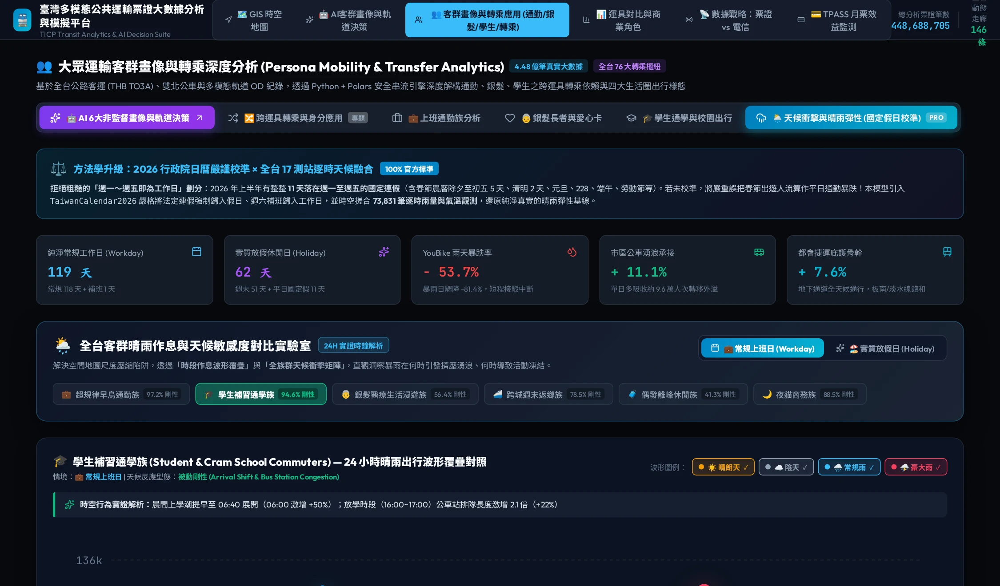

# Chapter 5: Four Micro-Personas & Weather Sensitivity — Who Moves? How Weather Reshapes Commuting Routes

🌐 **Language Switcher / 語言切換**: [ 🇬🇧 English ] | [ 🇹🇼 繁體中文版 ](../chapter5_personas_weather.md)

> *"Behind every cold, aggregated ridership curve, each tap has a human name: an engineer hurrying for morning check-in, or a grandmother holding her grandchild's hand on the metro to escape summer heat. When wind and rain arrive, their destinies diverge completely."*

---

## 5.1 Farewell to Faceless Big Data: From Coarse Aggregates to Microscopic Personas

Historically, municipal planning often relied upon undifferentiated "one-person, one-vote" gross ridership statistics. However, when policymakers focus solely on overall volume, they overlook the genuine pain points of vulnerable demographics:

* **If we only inspect peak passenger surges, we might conclude that off-peak metro service is unnecessary—yet off-peak trains are the sole mobility lifeline for seniors traveling to regional hospitals.**
* **If we assume everyone takes taxis when rain strikes, we ignore that students with TPASS monthly cards must still wait for feeder buses in the downpour.**

By deconstructing the statutory farecard classification codes (`TicketType`) within MOTC TICP ticketing data, this system reconstructs **Four Micro-Personas**, and introduces Taiwan's first **Weather Simulation Lab**.

---

## 5.2 In-Depth Profiles of the Four Micro-Personas

```
┌─────────────────────────┬─────────────────────────┐
│  👔 Iron Commuters      │  👵 Active Seniors      │
│  • Fare: TPASS Pass     │  • Fare: Senior Card    │
│  • Trait: Rigid Twin    │  • Trait: Off-Peak      │
│    Peak Commuter Tides  │    Clinic / Market Trips│
├─────────────────────────┼─────────────────────────┤
│  🎓 Gen-Z Students      │  🏖️ Weekend Tourists    │
│  • Fare: Student (02)   │  • Fare: Single Tokens  │
│  • Trait: Early Arrival │  • Trait: Scenic Hubs,  │
│    Cram School Clusters │    Weekend Influx       │
└─────────────────────────┴─────────────────────────┘
```

### 1. 👔 Iron Commuters
* **Core Attribute**: `TicketType=4` (TPASS Monthly Pass holders); cross-county regular commuters with rigid demand.
* **Temporal Rhythm**: Highly symmetrical "twin peaks" (07:30–09:00 morning rush; 17:30–19:30 evening rush).
* **Behavioral Traits**: Highly sensitive to travel time reliability, with low tolerance for transfer delays (preference for THSR-to-Metro or direct express coaches). TPASS policy dramatically reduced their marginal travel cost, normalizing cross-city living (e.g., Keelung ➔ Taipei; Taoyuan ➔ New Taipei).

### 2. 👵 Active Seniors
* **Core Attribute**: `TicketType=03/04` (Senior Welfare & Disability concession cards for age 65+).
* **Temporal Rhythm**: Completely avoids the commuter peaks! Travel concentrates between **09:30–11:30** (morning park exercise, traditional markets) and **14:00–16:00** (outpatient clinic visits, community elder academies).
* **Behavioral Traits**: Heavily reliant on barrier-free facilities, low-floor buses, and elevators. Extremely vulnerable to adverse weather, where slip-and-fall hazards suppress travel.

### 3. 🎓 Gen-Z Students
* **Core Attribute**: `TicketType=02` (High school and university student concession passes).
* **Temporal Rhythm**: Arrives at campus early (07:00), dismisses around 16:30–17:30, followed by a noticeable **"cram school dispersal peak" between 20:30 and 21:30**.
* **Behavioral Traits**: Clusters heavily near education corridors (e.g., Nanyang Street in Taipei, Yizhong District in Taichung, Kaohsiung Station Qianzhan) and evening night markets.

### 4. 🏖️ Weekend Tourists & Inbound Visitors
* **Core Attribute**: `Single-Journey Token`, `Mobile QR Ticket`, or short-duration travel passes.
* **Temporal Rhythm**: Low ridership during workdays; **surges from 10:00 on Saturdays and Sundays**, remaining elevated until 22:30 at night.
* **Behavioral Traits**: Heavily concentrated on Airport MRT, Jiufen coaches, Tamsui Ferry Pier, Ximending, and Pier-2 Art Center in Kaohsiung, featuring a high share of international tourists.

---

## 5.3 Behavioral Disruption in Wind and Rain: The Weather Simulation Lab

Weather is the most powerful **external disruptor** of transportation behavior. When the meteorological bureau issues a "Torrential Rain Warning," urban transit demand does not drop uniformly; instead, a dramatic **Modal Shift** takes place.

### 1. Four-Stage Weather Scenarios
The system supports 4-tier meteorological scenario simulations:

* **☀️ Sunny / Clear**: Baseline volume; all transit modes operate along standard schedules.
* **⛅ Cloudy**: Minor psychological effect; slight displacement from outdoor destinations toward indoor malls.
* **🌧️ Rainy**: Surface road speeds decrease by 15%; YouBike bike rentals plummet by 45%.
* **⛈️ Torrential Rain / Storm**: Extreme weather stress test; severe street ponding and impaired visibility.

### 2. Modal Elasticity under Torrential Rain
Empirical data reveals starkly divergent fates across transportation modes during storms:

```
🚲 YouBike Bikeshare   ───▼ -78.4%  (Almost fully halted, shifting to walking or bus)
🚌 Urban City Bus      ───▼ -22.6%  (Surface gridlock and wet boarding deter riders)
🚗 Freeway Auto Traffic ───▼ -14.2%  (Low visibility suppresses non-essential trips)
🚆 Metropolitan Metro  ───▲ +8.3%   (Shelter of choice! Underground tracks immune to rain)
🚅 High-Speed Rail     ───  -1.2%   (Long-haul rigid demand remains steadfast)
```

### 3. Elderly Vulnerability to Extreme Weather
The most poignant empirical finding concerns senior citizens:  
When conditions shift from "Sunny" to "Torrential Rain," **65+ senior citizen transit card taps plummet by 62.8%**!  
This quantitatively demonstrates that extreme weather imposes severe "spatial isolation" on senior citizens. The provision of community healthcare shuttles and sheltered rain corridors is an urgent priority in an aging society.


*Figure 5.1: Live Application Interface — Weather Simulation Lab showing YouBike rentals plunging -53.7%, bus surges absorbing +11.1%, and metro shelters carrying +7.6% under torrential rain, alongside 24-hour student commuting waveforms.*

---

## 5.4 🛠️ Hands-on Operational Walkthrough: Testing Scenarios

* **[👉 Launch Live Application: Personas & Weather Simulation Lab](https://tobytoy.github.io/taiwan-mobility-pulse/#personas)**

### Operational Steps:
1. Click the link above or click **【Micro-Personas】** on the top navigation bar.
2. **Switch Persona Sub-Tabs**:
   * Click **"👔 Iron Commuters"**: Observe the sharp twin peaks in the time series and high-speed rail/metro hub concentrations.
   * Click **"👵 Active Seniors"**: Observe the gentle midday curve and hospital clusters around Taipei Veterans General Hospital and NTU Hospital.
   * Click **"🎓 Gen-Z Students"**: Observe the evening cram school dispersal wave.
3. **Trigger the Weather Simulation**:
   * On the right weather control bar, switch between **Sunny**, **Cloudy**, **Rainy**, and **Torrential Rain**.
   * Watch the modal shift delta meters react in real time!

---

## 5.5 🔍 Core Analytical Insights

> **💡 Policy Takeaway**:  
> Public transit resilience is not measured by sunny day capacity, but by stormy day adaptability. When severe rain transfers hundreds of thousands of commuters from bikeshare and light mobility into underground subways, rapid transit operations centers must deploy spare train sets in advance to accommodate the sudden wave of rain-diverted passengers.

Having examined how meteorological forces disrupt daily trips, we expand our view in the next chapter to examine 30 years of macroeconomic climate change across the island of Taiwan!

👉 **[Proceed to Chapter 6: Islandwide Climate Pulse & Microclimate Livability](chapter6_climate_pulse.md)**
