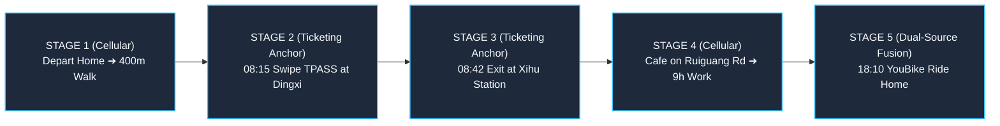

# Chapter 8: National Multi-Source Data Fusion Strategy — Door-to-Door Closed Loop & Policy Selection Matrix

🌐 **Language Switcher / 語言切換**: [ 🇬🇧 English ] | [ 🇹🇼 繁體中文版 ](../chapter8_data_fusion_strategy.md)

> *"A single data source captures only one fragment of the puzzle: transit ticketing sees order within the faregates, eTag sees speed upon the freeway, and cellular signaling sees wandering on the open streets. Only through rigorous fusion can one behold the complete soul of this island."*

---

## 8.1 The Ultimate Vision: From Data Silos to the "Door-to-Door Closed Loop"

For decades, transportation data across Taiwan remained trapped within bureaucratic and corporate silos:

* Taipei Metro, Taiwan High Speed Rail, and Taiwan Railway maintained isolated ticketing repositories;
* The Freeway Bureau operated the vast eTag highway tolling infrastructure;
* Telecommunications carriers (Chunghwa Telecom, Far EasTone) held signaling logs from tens of millions of mobile subscribers.

Each system operated in isolation, generating fragmented data islands.  
Yet a real citizen lives a seamless, undivided daily life: they do not reside permanently inside a metro station, nor do they spend eternity driving upon a freeway.  
**A modern smart nation strategy must achieve the "1 + 1 + 1 > 3 Door-to-Door Full-Day Travel Closed Loop".**

---

## 8.2 Yonghe ➔ Neihu Xihu: 5-Stage Door-to-Door Journey Reconstruction

To demonstrate the transformative power of data fusion to public planners and decision-makers, this system reconstructs one of the most famous commuting journeys in Taiwan: **from Yonghe District in New Taipei City to the Neihu Technology Park in Taipei**:



### 1. STAGE 1: Cellular-Led (Home Departure ➔ Walking)
* **Time**: 08:00 - 08:15
* **Data Contribution**: Cellular signaling captures the user departing their residential high-rise in Yonghe, walking 400 meters along Zhulin Road toward MRT Dingxi Station.
* **Value**: Bridges the ticketing blind spot between home doorstep and the transit turnstile.

### 2. STAGE 2: Ticketing-Led (Hard Ground Truth: Swiping TPASS)
* **Time**: 08:15
* **Data Contribution**: The passenger swipes their card at the Dingxi Station faregate. The system tags their identity as an **"Iron Commuter holding TPASS #NOR-1200"**.
* **Value**: **Eliminates base station spatial drift!** Millisecond-level turnstile timestamps establish that the passenger entered the underground rail network, proving they are not driving an automobile.

### 3. STAGE 3: Ticketing-Led (Hard Ground Truth: Transit Ride ➔ Alighting at Xihu)
* **Time**: 08:15 - 08:42
* **Data Contribution**: The passenger transfers at C.K.S. Memorial Hall Station (Songshan-Xindian Line) and Nanjing Fuxing Station (Wenhu Line), exiting the faregate at Xihu Station at 08:42.
* **Value**: Captures multi-line transfer sequences and establishes the passenger's daytime destination as an **employee of Neihu Science Park**.

### 4. STAGE 4: Cellular-Led (Commercial Dwell & Daytime Office Work)
* **Time**: 08:45 - 18:00
* **Data Contribution**: Upon exiting, cellular signaling detects a 15-minute dwell at a coffee shop on Ruiguang Road (breakfast purchase), followed by a 9-hour stay inside a corporate technology headquarters.
* **Value**: Fills the vast spatial void after exiting the transit gate, quantifying the direct retail spending generated by rail transit passengers.

### 5. STAGE 5: Dual-Source Fusion (Evening YouBike Rental ➔ Closed-Loop Return)
* **Time**: 18:10 - 18:35
* **Data Contribution**: After work, the user unlocks a YouBike beside Xihu Station. Cellular signaling records a continuous 25-minute scenic ride along the Keelung River bikeway before docking the bike and walking home.
* **Value**: Ticketing logs provide the financial deduction contract, while cellular signaling traces the recreational riverside trajectory, completing **100% closed-loop tracking of full-day green transit**!

---

## 8.3 Hard Ground Truth Anchoring Calibration

Historically, cellular signaling analytics suffered from a notable vulnerability: estimation accuracy hovered around ~70%, plagued by carrier market share expansion biases and roaming user noise.  
Our system introduces a groundbreaking engineering paradigm: **【Inversely Calibrate Cellular Signaling Using Hard Ground Truth Anchors】**.

```
       [ MOTC TICP Transit Ticketing Census (100% Census) ]
       [ Freeway Bureau eTag Gantry Absolute Flows (0m Drift) ]
                            │
                            ▼ (Physical Golden Anchors for Volume & Coordinates)
           ╔═════════════════════════════════════╗
           ║    Inverse Calibration Algorithm    ║
           ╚═════════════════════════════════════╝
                            ▲
                            │ (Dynamically tune expansion & route assignment)
       [ Cellular Carrier Base Station Signaling Big Data ]
```

### Three Core Inverse Calibration Mechanisms:
1. **Dynamic Expansion Factor Tuning**:  
   Carriers conventionally apply a fixed uniform multiplier (e.g., 2.63× for a 38% market share). However, at specific stations (e.g., Zhongli Station with high migrant worker densities, or Zhubei Station with high corporate executives), carrier market shares deviate wildly. By using transit turnstile census counts as the ground truth denominator, the system **dynamically recalculates the actual cellular sampling ratio for that spatial-temporal grid**, eliminating expansion distortion.
2. **Map-Matching Ground Truth Snapping**:  
   When cellular signaling hesitates between elevated National Freeway 1 and the underground Zhonghe-Xinlu Metro line, a simultaneous card swipe at Dingxi Station causes the system to **automatically snap 100% of the signaling weight to the subterranean rail network**, instantly dispelling spatial route hallucinations.
3. **Privacy-Preserving Spatiotemporal Co-occurrence**:  
   Zero personal names, national ID numbers, or phone numbers are ever exchanged. Operating on feature layers within a Federated Learning architecture, the system aligns only temporal minute intervals and spatial gantry/turnstile coordinates, achieving behavioral synthesis strictly behind privacy compliance boundaries.

---

## 8.4 Policy & Commercial Decision-Making Selection Matrix

In practice, public agencies and enterprise buyers frequently struggle with data procurement choices: "Which data should we purchase for our specific needs?" This handbook provides an authoritative decision guide:

| Analytical Objective | Optimal Data Source Combination | Engineering Rationale |
|:--- |:---|:---|
| **TPASS Budget Subsidy Audit** | **TICP Ticketing Data (100% Mandatory)** | Legal financial audit contracts and statutory fare types are mandatory for Treasury write-offs. |
| **Freeway Bottleneck & EV Siting**| **eTag Gantry Flows + TDX Parking APIs** | 0m chainage precision and statutory 5-class vehicle breakdown are required for capacity engineering. |
| **National Scenic Park Tourism** | **Cellular Signaling + TDX Scenic CCTV** | Captures ticketless open-air tourists, scenic dwell times, and visual ground truth. |
| **TOD Commercial & Retail Planning**| **Ticketing (Anchors) + Cellular (Catchments)** | Anchors station exit counts while mapping surrounding street shopping and walking radii. |
| **Islandwide Multi-Modal Split** | **TICP (Rail/Transit) + eTag (Highway)** | Purest mutually exclusive combination; streams add together directly with zero double-counting. |

---

## 8.5 🛠️ Hands-on Operational Walkthrough

* **[👉 Launch Live Application: Multi-Source Fusion & Decision Guide](https://tobytoy.github.io/taiwan-mobility-pulse/#telecom)**

### Operational Steps:
1. Click the link above or click **【Telecom vs. Ticketing】** on the top navigation bar.
2. Navigate to **【🌐 Act II: Multi-Source Data Fusion & Door-to-Door Closed Loop】**.
3. Inspect the **5-Stage Interactive Journey Diagram** (Yonghe ➔ Neihu Xihu).
4. Review the **"Government & Enterprise Procurement Decision Matrix"** to assess data trade-offs for your organization's projects.

---

## 8.6 🔍 Core Strategic Takeaways

> **💡 Executive Takeaway**:  
> In public policy, there is no single "magic bullet" dataset. The mark of mature data engineering is knowing which dataset provides the rigid baseline truth, which provides spatial coverage, and how to use the former to anchor and calibrate the latter.

Now that we have established the theoretical framework for national multimodal data fusion, we culminate in Chapter 9 by examining its ultimate operational manifestation: real-time scenic tourism intelligence, 4K live CCTVs, and holiday traffic management!

👉 **[Proceed to Chapter 9: Scenic Tourism, Live CCTVs & Holiday Traffic Dispersal](chapter9_tourism_mobility_cctv.md)**
