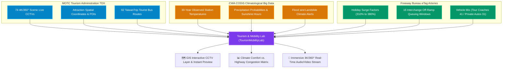

# Chapter 9: Scenic Tourism, Live CCTVs & Holiday Traffic Dispersal — Mountain-Coast Pulses & Real-Time Travel Intelligence

🌐 **Language Switcher / 語言切換**: [ 🇬🇧 English ] | [ 🇹🇼 繁體中文版 ](../chapter9_tourism_mobility_cctv.md)

> *"On workdays, national highways serve as the steel arteries of industrial supply chains and commuter tides; on holidays, they become the emotional conduits of twenty-three million souls escaping toward mountains and seas. When high-speed rail terminates and off-ramp traffic overflows, how do we harness live visual streams and climatological data to master the nation's tourism pulse?"*

---

## 9.1 The Nature of Tourism Mobility: From "Rigid Convergence" to "Holiday Dispersion"

In preceding chapters, we explored the "rigid mobility skeleton" shaped by daily urban commuting (twin peaks, inward radial convergence) and weekday freeway logistics. However, Taiwan's compact geography—where towering alpine peaks rise minutes from the ocean—fosters a uniquely volatile **"Tourism Spatiotemporal Tide"**:

1. **Explosive Traffic Flow Multipliers (+280% to +420%)**:  
   Compared to quiet weekday baselines, traffic along National Freeway 5 (Hsuehshan Tunnel), Freeway 6 (Puli / Sun Moon Lake), Freeway 3 Nanzhou (toward Kenting), and Provincial Highway 18 (Alishan) surges to **3.2× normal volumes**, while air and ferry routes to offshore Penghu explode to **4.2×**.
2. **Full-Day Plateau Congestion & Unidirectional Tides**:  
   Unlike brief commuting rush hours (07:30–09:00, 17:30–19:00), tourism exhibits a **prolonged morning outbound plateau (08:30–13:00)** and a **drawn-out afternoon return congestion (14:30–21:00)**, tightly constrained by high-occupancy vehicle (HOV) restrictions, ramp metering, and single-lane mountain passes.
3. **Extreme Weather Sensitivity**:  
   Leisure travel depends on weather to an extent far exceeding work commuting. A single afternoon convective storm or coastal monsoon swell instantly reroutes Wai'ao surfers, Hehuanshan visitors, and Penghu island-hoppers.

To liberate planners and travelers from relying on delayed surveys or guesswork, **v1.3.0** deploys a four-dimensional national fusion framework:  
**【TDX Tourism APIs × CWA CODiS 30-Year Climatology × Tourism Administration 74 4K/360° Live CCTVs × Freeway Bureau eTag Holiday Traffic Data】**.

---

## 9.2 Cross-Source Fusion Architecture: Scenic CCTV, Climatology, and Arteries

### Data Alignment Specifications

| Dimension | Data Source | Scale | Key Attributes & Metrics |
| :--- | :--- | :--- | :--- |
| **Live Sight** | MOTC Tourism TDX Live Feed Service | 74 Scenic CCTVs Islandwide | `Location`, `LiveURL`, `IFrameURL`, `ViewType` (360° Panoramic / PTZ / Fixed), `Status` |
| **Climate Pulse** | CWA CODiS Weather Database | Nearest 30-Year Weather Station | Seasonal temperatures, summer cooling comfort, annual rain days, best travel months, storm warnings |
| **Mobility Arteries** | Freeway eTag + TaiwanTrip | 111 Dynamic Corridors, 92 Bus Routes | Key highway corridors (Hwy 18, Fwy 5, Hwy 11), holiday surge multipliers, peak hours, THSR/TRA links |

*Figure 9-1: Live Application Interface — Tourism Destinations & Live CCTV Dashboard spanning six geographical clusters, CODiS historical travel windows, eTag holiday surge multipliers, and TaiwanTrip bus connections.*

---

## 9.3 In-Depth Mobility Profiles across Six Scenic Clusters

*Figure 9-2: Live Application Interface — Immersive 4K / 360° Live Streaming Window (Matsu Nangan Iron Fort demo), featuring an ad-free stream paired with real-time weather and highway transit sidebars.*

### 1. Chiayi Alishan Alpine Sea of Clouds Corridor (11 Live Feeds)
* **Flagship Spots**: Eryanping Trail, Taiping Suspension Bridge, Fenqihu Old Street, Sheng-Le Farm, Lijia Station, Niupuzi Prairie.
* **CODiS Climate**: Alishan Station (elevation 2,213m), annual mean temperature 11.8°C (summer mean 14.5°C), making it Taiwan's premier summer retreat; autumn and winter feature dry, crisp air with optimal visibility for cloud seas.
* **eTag Highway Artery**: Freeway 3 Zhongpu Interchange ➔ Provincial Highway 18 (Alishan Hwy). Weekend traffic surges by **+340%**, outbound peak between 08:30–11:30; afternoon mountain fog triggers early downhill return queues from 14:00.
* **Transit Recommendation**: THSR/TRA Chiayi Station connecting to "TaiwanTrip Alishan Route (7322 / 7329)", offering dedicated right-of-way without mountain driving fatigue.

### 2. Nantou Sun Moon Lake Multimodal Cluster (7 Live Feeds)
* **Flagship Spots**: Ita Thao Pier, Wenwu Temple, Nine Frogs Stack, Jinlong Mountain Sunrise, Ci'en Pagoda, Dakeleha Overwater Bikeway.
* **CODiS Climate**: Sun Moon Lake Station (elevation 1,015m), annual mean temperature 19.5°C; autumn (Sept–Nov) is the most pleasant season for the International Fireworks & Music Festival. The Nine Frogs Stack serves as an empirical indicator of dry-season water storage.
* **eTag Highway Artery**: Freeway 3 Wufeng Junction ➔ Freeway 6 Ailan Interchange ➔ Highway 21. Holiday traffic swells to **3.1× normal volume**, with off-ramp backups at Ailan regularly extending onto the freeway before noon.
* **Transit Recommendation**: Take "TaiwanTrip Sun Moon Lake Route (6670)" from THSR Taichung Station directly to Shuishe Pier and lakeside loop bus (6669).

### 3. Northeast Coast, North Coast & Yilan Surfing Corridor (15 Live Feeds)
* **Flagship Spots**: Wai'ao Beach (facing Guishan Island), Yehliu Geopark, Fulong Beach, Zhongjiao Bay, Laomei Green Reef, Bitou Cape.
* **CODiS Climate**: Fugueijiao and Suao Stations, annual mean temperature 22.1°C. Winter brings the northeast monsoon, while summer transforms the coast into a water sports haven; Laomei Green Reef is a seasonal phenomenon limited to March–May.
* **eTag Highway Artery**: Freeway 5 Hsuehshan Tunnel ➔ Toucheng Interchange ➔ Highway 2 Coastal Road. Saturday morning southbound delays and Sunday afternoon northbound queues extend up to 8 km, with traffic volume exploding **+380%**.
* **Transit Recommendation**: Ride TRA Yilan Line Fast Locals directly to Toucheng/Wai'ao, or connect via TaiwanTrip Coastal Dunes Route (Green 18) and Crown North Coast Route (716).

### 4. East Rift Valley, Coastal Artery & Green Island (14 Live Feeds)
* **Flagship Spots**: Sanxiantai Arch Bridge, Jialulan Recreation Area, Jinzun Surf Spot, Luye Highland (Hot Air Balloon Festival), Liushidan Mountain Daylilies, Shitiping, Green Island Fanchuanbi.
* **CODiS Climate**: Chenggong and Taitung Stations, annual mean temperature 23.8°C; a warm maritime climate with virtually no winter. Summer and autumn require vigilance for Pacific typhoon landfalls.
* **eTag Highway Artery**: Highway 9 (Valley) and Highway 11 (Coast). Holiday cross-county road trips surge by **+260%**.
* **Transit Recommendation**: TRA Eastern Mainline (EMU3000 New Ziqiang) to Taitung Station, transferring to "TaiwanTrip East Coast Route (8101A)".

### 5. Southern Sunshine, Kenting & Dapeng Bay (12 Live Feeds)
* **Flagship Spots**: Kenting Nanwan, Baisha Bay, Eluanbi Lighthouse, Jialeshui, Dapeng Bay Sailing Base, Liuqiu Island Beauty Cave.
* **CODiS Climate**: Hengchun Station, annual sunshine hours exceed 2,048 hours; winter features strong downhill katabatic winds (Luoshanfeng), while summer delivers quintessential tropical sunshine.
* **eTag Highway Artery**: Freeway 3 Nanzhou Interchange ➔ Highway 1 / Highway 26. Surges by **+310%**, with off-ramp congestion peaking Friday evening and Sunday afternoon.
* **Transit Recommendation**: Board "TaiwanTrip Kenting Express (9189)" from THSR Zuoying Station, reaching Kenting in 120 minutes via highway express lanes.

### 6. Offshore Archipelagos: Matsu, Kinmen & Penghu (15 Live Feeds)
* **Flagship Spots**: Matsu Nangan Iron Fort, Beigan Qinbi Village, Dongyin Lighthouse, Kinmen Gugang Lake, Penghu Guanyinting (Fireworks Festival), Erkan Historic Village.
* **CODiS Climate**: Island maritime weather; March–May brings spring advection fog disrupting flight schedules, while summer offers vibrant maritime tourism.
* **eTag & Mobility**: Air and sea passenger volumes swell by **+420%** during peak summer festival dates.
* **Transit Recommendation**: Island public buses paired with TaiwanTrip Kinmen/Penghu routes, avoiding rental scooter exhaustion under extreme sun.

---

## 9.4 🛠️ Hands-on Operational Walkthrough: CCTV & Tourism Hub

* **[👉 Launch Live Application: Scenic Destinations & Live CCTV Dashboard](https://tobytoy.github.io/taiwan-mobility-pulse/#tourism)**

### Operational Steps:
1. Click the link above or click **【📷 Scenic CCTV (74)】** on the top navigation bar.
2. **Filter by Region & Visual Mode**:  
   Click the cluster buttons (e.g., **"Chiayi Alishan"**, **"Yilan & Northeast Coast"**, or **"Offshore Islands"**) to filter the 74 destinations.  
   Toggle between **"360° Panoramic"**, **"Pan-Tilt-Zoom (PTZ)"**, and **"Fixed Lens"**.
3. **Open the Immersive Live Stream**:  
   Click on the **"🎥 Watch Live Stream"** button on any card.  
   The modal window streams an ad-free 4K YouTube Live feed, accompanied by local CODiS weather metrics, eTag holiday surge multipliers, and TaiwanTrip bus connections.
4. **Switch to GIS Map CCTV View**:  
   Navigate to **【GIS Map】➔【Dynamic FlowMap】** and toggle the **"📷 74 Scenic CCTVs"** button on the control bar. Golden camera pins will appear across Taiwan, allowing you to preview scenic feeds directly on the map alongside dynamic traffic flows!

*Figure 9-3: Live Application Interface — FlowMap featuring the golden CCTV layer activated, displaying 74 live camera pins across Taiwan alongside dynamic transit particles.*

---

## 9.5 🔍 Public Policy & Smart Travel Insights

> **💡 Smart Mobility Takeaway**:  
> Traditional holiday traffic management relied on static roadside variable message signs (CMS). By fusing live 4K scenic video feeds with highway congestion surge factors and real-time public transit routes, travelers can verify destination weather and crowd densities *before* embarking, shifting discretionary trips toward green transit or off-peak hours and achieving distributed traffic equilibrium.

---

### 🎉 Monograph Conclusion: The Living Pulse of Taiwan

Over 9 macro chapters, we have journeyed from the foundational data philosophy of rigid ticketing baselines and zero-drift highway sensors, through 111 dynamic corridors, off-ramp catchment halos, micro-personas, 30-year climate trends, and TOD commercial hubs, culminating in live 4K scenic video streams.

Taiwan's mobility pulse is neither a static map nor cold numbers in an audit report. It is the living, synchronized rhythm of 23 million people interacting with their island's mountains, coasts, cities, and weather. May this interactive monograph serve as an illuminating benchmark for intelligent transportation engineering, urban spatial science, and national data governance!
